# 라이브지니(LiveGenie, 가칭) 기획서

> **요술램프 지니처럼, 라이브 셀러가 원하는 운영 업무를 뚝딱 해결해 주는 솔루션**
> 찜 접수·선착순 판정·라벨·영수증·입금 확인·포장·택배 접수까지 라이브 방송 판매의 뒷일을 한 번에 처리한다.
>
> 처음 작성 2026-10-20 · 개정 2026-10-22(이름·완성 기능·업종 확장·간편 로그인·택배 접수·사업화 현황 반영)
> 대상: 다육식물 라이브 판매 농장(첫 고객) → 댓글로 주문받는 소상공인 라이브 판매 전반(식품·화분·의류·잡화)
> 이전 가칭은 **라이브찜**이다. 저장소·코드·일부 문서에는 아직 그 이름이 남아 있다. "라이브지니"도 상표 확인 전이라 가칭이다([3.5](#35-지식재산연구기술-제휴)).
> 근거 문서: [요구사항 명세](spec/SPEC.md) · [판정·금액 규칙](spec/DOMAIN_RULES.md) · [라벨 규칙](spec/LABEL_RULES.md) · [요금 규칙](spec/BILLING_RULES.md) · [기술 검토](TECH_REVIEW.md) · [결정 기록](DECISIONS.md) · [진행 보고](FINAL-REPORT.md) · [사장님 할 일 안내](OWNER-GUIDE.md) · [연습 모드](TRY-IT.md)

---

## 한 장 요약

| 항목 | 내용 |
|---|---|
| 문제 | 라이브 판매 1회에 상품 수십~수백 개가 팔린다. 찜 기록·선착순 판정·라벨·구매자별 합산·입금 확인·택배 접수를 사람이 손으로 하거나, 1회 9~10만 원을 내고 스태프나 전용 AI 서비스를 쓴다. 기존 다육 AI 서비스는 45만 원짜리 전용 프린터와 전용 라벨에 묶여 있고, 늦게 올라온 지난 번호 찜을 놓치고, 회당 요금만 있다. 의류·식품 라방은 댓글이 번호가 아니라 `반바지 M`·`초코 과자 3`이라 번호 선착순 도구로는 받을 수 없다. |
| 해결 | 웹 서비스 하나(설치 없음)로 유튜브·인스타그램·틱톡 댓글을 모아 **상품별·옵션별 선착순을 자동 판정**한다. 판매자가 이미 가진 라벨프린터(NIIMBOT B1·Marklife·바우아토)로 바로 출력하고, 라벨 없이 **영수증(PDF·그림)·공유 링크·엑셀·입금 확인·포장**까지 끝낸다. 택배 자동 접수와 간편 로그인을 개발 중이다. |
| AI | ① 방송자의 말("15번 핑크프릴 만 원이요")을 상품 등록 카드로 바꾸는 **음성 상품 등록**. ② 번호·상품명·옵션·수량을 읽는 **댓글 주문 인식**(애매하면 자동으로 정하지 않고 "확인 필요"로). ③ 입금자명과 구매자를 잇는 **입금 매칭**. 돈과 순서는 AI가 아니라 검증된 규칙 엔진이 정한다. AI는 입력을 돕고, 사람이 확정한다. |
| 차별점 | 프린터 자유(추가 장비 0원) · 늦은 찜(돌려보기 시청자) 처리 · 3개 플랫폼 동시 방송 · **상품 옵션(사이즈·색·기종·수량)과 변형별 재고** · 라벨 켜기/끄기 · 입금 확인 · **정액제(월) + 방송 일권·주문 건권** · 판정 근거 기록 |
| 시장 | 국내 라이브커머스 4.7조 원(2025, +35%). **TAM 4.7조 원 → SAM 2.1조 원 → SOM 약 5,600억 원**(2031년 처리 거래액, 추정). 해외에서는 같은 유형(CommentSold)이 판매자 6,000명으로 연 1.3조 원을 처리했다 |
| 수익 | 이용권(정액제 30일·방송 일권·주문 건권·라벨 장권) + 입금 연동·택배 접수·알림톡 부가 서비스 + 프린터·라벨 제휴. 2031년 연 환산 매출 약 32억 원(추정) |
| 운영 주체 | 개인사업자 **틈(TEUM)** — 간이과세자. 통신판매업 신고 완료(2026-03), 응용 소프트웨어 개발·공급업 추가(2026-10-22) |
| 현재 상태 | 2026-10-18 개발 시작. 2026-10-22 기준 **다육 라이브 판매 24개 묶음 완성**(메인에 모두 들어감), **업종 확장(상품 옵션)** 엔진·화면·라벨·문서 완성. 옵션 통합 시험·간편 로그인·택배 자동 접수 진행 중. 커밋 906개, 코드 약 22만 줄, 시험 파일 453개, 결정 기록 약 370건. 외부 계정·실물 기기는 모두 가짜(모의) 연결로 시험했다 |

---

## 1. 목적 및 필요성

### 1.1 문제 인식

#### 현장의 하루: 다육이 라이브 판매 1회에 생기는 일

다육이 농장은 유튜브 라이브를 켜고 화분을 하나씩 보여 주며 판다. 방송자가 "194번, 왕비뇌신금, 8천 원"이라고 말하면 시청자가 채팅에 `194`를 쓴다. 가장 먼저 쓴 사람이 산다. 이 흐름이 방송 1회에 수십~수백 번 반복된다.

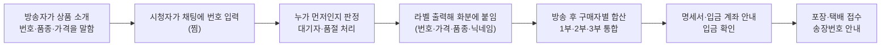

| 단계 | 지금은 누가, 어떻게 | 생기는 문제 |
|---|---|---|
| 상품 등록 | 방송자가 말하면 스태프가 엑셀에 받아 적는다 | 방송 중 손이 바쁘다. 받아 적다 놓치거나 가격을 틀린다 |
| 찜 접수·선착순 | 스태프가 채팅을 눈으로 따라가며 1등을 고른다 | 채팅이 빠르면 순서를 틀린다. 같은 번호를 두 사람에게 판다. 구매자와 다툼이 생긴다 |
| 늦게 온 찜 | 방송을 돌려보는 시청자가 한참 전에 나온 번호를 늦게 올린다 | 이미 지나간 번호라 놓친다. 판매 기회를 잃는다 |
| 문자 찜 | 채팅 대신 문자로 번호를 보내는 단골이 있다 | 채팅 찜과 누가 먼저인지 정할 규칙이 없다 |
| 라벨 | 손으로 쓰거나, 휴대폰 라벨 앱에 하나씩 쳐서 출력한다 | 방송 속도를 못 따라간다. 글씨를 잘못 쓴다 |
| 합산·명세서 | 방송 끝나고 엑셀로 구매자별 합계를 낸다(1부·2부·3부를 다시 합친다) | 몇 시간이 걸린다. 합계·배송비 계산을 틀린다 |
| 입금 확인 | 은행 앱 입금 내역과 엑셀을 눈으로 맞춘다 | 입금자명이 닉네임과 달라 헷갈린다. 확인이 늦어 배송이 밀린다 |
| 택배 접수 | 구매자에게 주소를 따로 묻고, 택배사 사이트에 한 건씩 옮겨 적는다 | 주소를 잘못 옮긴다. 송장번호를 구매자에게 다시 하나씩 보낸다 |

#### 다른 업종에서는: 댓글이 번호가 아니다

식품·화분·의류·휴대폰 케이스 라방은 같은 상품을 사이즈·색·기종·수량으로 나눠 판다. 댓글도 `반바지 M`, `초코 과자 3`, `아이폰 17 프로`, `흰색 대형 2개`처럼 쓴다. 번호 선착순 도구는 이런 댓글을 주문으로 읽지 못하고, 범용 주문 도구는 주문서 링크로 보내 라방의 "먼저 쓴 사람이 산다" 흐름이 끊긴다. `반바지 M`이 다 팔려도 `반바지 L`은 팔아야 하는데, 이를 따로 세는 도구도 드물다.

#### 판매자는 누구인가

- 다육 농장주는 연령대가 높다. 업계 관계자는 "대부분 부모님 나이대보다 10살 많다고 생각하면 된다"고 했다. 농가 경영주 전체로 보면 평균 67.7세, 60세 이상이 78.8%다(2025 농림어업총조사 잠정) [41]. 컴퓨터가 낯설고, 복잡한 설치·가입·설정을 어려워한다.
- 방송은 농장마다 월 2회 안팎에서 주 몇 회까지 다양하다. 한 번 할 때 1부·2부·3부로 길게(4시간 이상) 하기도 한다 [39][40]. 현장에서는 진행자, 찜 스티커 쓰기, 정산, 포장으로 사람을 나눠 쓴다 [23].
- 라벨프린터는 사람마다 제각각이다. 휴대용 NIIMBOT B1, Marklife(예: X2), 바우아토 등을 이미 갖고 있다.
- 유튜브만 하지 않는다. 인스타그램·틱톡 라이브도 하고, 같은 방송을 여러 곳에 동시에 내보내기도 한다.
- 라벨을 쓰지 않는 판매자도 있다. 라벨 없이 방송이 끝나면 바로 영수증만 보내는 사람도 있다.
- 식품·의류·잡화 판매자는 다육 농장보다 방송이 잦고 한 방송의 주문 건수가 많을 수 있다(추정 — 파일럿 인터뷰로 확인). 이들에게는 옵션·수량과 택배 접수가 핵심이다.

#### 기존 방법과 서비스의 한계

| 방법 | 비용(공개 자료·업계 정보) | 한계 |
|---|---|---|
| **사람 스태프(전산·찜 스티커 알바)** | 회당 4.5만 원 ~ 일급 15만 원(구인 공고) [18]~[21]. 업계에서는 "기본 10만 원" | 매번 사람을 구해야 한다. 사람이 하므로 실수가 난다. 방송이 길어지면 비용이 늘어난다. 정리는 따로 엑셀로 한다 |
| **도움봇**(다육 라방 AI) [1] | 전용 프린터 구매 45만 원 또는 협력 유튜버 방송일에 한해 하루 3만 원 대여. 전용 라벨 100장 1만 원(타사 라벨을 쓰면 계약 종료). AI 모드 하루 4만 원(3시간까지) + 1시간마다 1만 원, 보급형(사람이 입력) 하루 2만 원. 업계에서는 "AI 기본 9만 원"(AI 모드 + 프린터 대여로 추정) | ① **전용 프린터 구매가 사실상 필수**이고 라벨도 전용품만 쓸 수 있다. ② 방송을 돌려보는 시청자가 **지난 번호를 늦게 올리면 잡지 못한다**(사용자 현장 확인). ③ **회당(일당) 요금**뿐이다. 월 2회 방송하는 농장은 월 회원권을 원한다. ④ 시간제 요금이라 4시간 넘는 다육 방송에서는 하루 5~6만 원이 된다 |
| 범용 라방 주문 도구 | 월 3.3만~20만 원. 설치비 80만 원이나 매출 2~3.8% 수수료를 받는 곳도 있다 [3]~[12] | 의류·식품 쇼핑몰형이다(주문서 링크·크롬 확장·수동 기록). 다육 라방의 "숫자 채팅 선착순 → 라벨 → 화분" 흐름과 맞지 않는다. 라벨 기종이 정해져 있거나 라벨이 없다. 늦게 올린 지난 번호 처리와 판정 근거 기록은 어느 서비스 자료에도 없다 |
| 엑셀·수기 | 0원 + 사람 시간 | 방송 중에는 불가능에 가깝다. 방송 후 정산에 몇 시간이 걸리고 실수가 많다 |

> 경쟁 서비스의 상세 비교는 [2.3 시장분석](#23-시장분석)에 있다.

업계 대화에서 나온 한 문장이 문제를 요약한다. **"사람은 기본 10만 원, 저 AI는 기본 9만 원. 그러면 소비자들은 AI 안 쓰고 사람 쓰게 되어 있다."** 지금 AI 서비스는 사람보다 확실히 싸지도 않고, 장비 부담은 더 크다. 그래서 자동화가 퍼지지 않는다.

### 1.2 기획 의도

**방향: "가진 장비로, 싸게, 실수 없이, 쉽게 — 방송 뒤 택배까지"**

| 방향 | 무엇을 하나 | 해결하는 문제 |
|---|---|---|
| ① 장비 자유 | NIIMBOT B1·Marklife·바우아토를 브라우저에서 바로 출력한다. 라벨을 끌 수도 있다. 어떤 프린터든 라벨 그림(PNG·PDF)으로 출력할 수 있다 | 45만 원 전용 프린터와 전용 라벨 종속 |
| ② 정확한 판정 | 상품별(옵션이 있으면 변형별) 선착순을 규칙 엔진이 판정한다. 지난 번호의 늦은 찜, 공개 전 찜, 문자 찜과의 경합, 취소·승계, 수량 부족을 규칙으로 처리한다 | 순서 실수, 중복 판매, 늦은 찜 놓침, 구매자 다툼 |
| ③ 업종 확장 | 상품마다 옵션(사이즈·색·기종·수량)과 변형별 재고를 둔다. "상품명·옵션도 받기" 방송에서 `반바지 M`·`초코 과자 3`을 읽는다. 애매한 댓글은 자동으로 정하지 않고 "확인 필요"로 모은다 | 번호 선착순 도구로는 받을 수 없는 식품·의류·케이스 라방 |
| ④ 사람보다 확실히 싼 요금 | **정액제(30일)** 와 방송 일권·주문 건권 중에서 고른다. 리허설은 언제나 무료 | 회당 9~10만 원 부담. 월 2회 방송 농장에 맞지 않는 요금 |
| ⑤ 방송 후까지 한 번에 | 구매자별 합산(회차 통합) → 확인서 PDF·그림·공유 링크 → 엑셀 → 입금 확인 → 포장 → 택배 접수(진행 중) | 방송 후 몇 시간 걸리는 정산·입금 대조·택배 입력 |
| ⑥ 어디서 방송하든 | 유튜브·인스타그램·틱톡 댓글을 한 화면으로 모은다. 동시에 내보내도 된다 | 플랫폼마다 다른 도구 |
| ⑦ 고령 판매자도 쉽게 | 설치 없는 웹. 시작 마법사, 쉬운 한국어, 큰 버튼, 휴대폰 아래 메뉴, 연습 모드. 간편 로그인(구글·카카오·네이버) 진행 중 | 디지털 기기가 낯선 농장주 |

**추진 배경**

1. **라이브 판매가 소상공인의 기본 판로가 됐다.** 유튜브·인스타그램·틱톡 라이브는 따로 입점하지 않아도 바로 팔 수 있어서 농가·화훼·식품·의류·수공예 판매자가 많이 쓴다. 하지만 이런 "플랫폼 밖 라이브"에는 주문 관리 도구가 거의 없다.
2. **기술 조건이 무르익었다.**
   - 브라우저가 블루투스로 라벨프린터에 직접 출력할 수 있게 됐다(Web Bluetooth). 그래서 설치형 프로그램이 필요 없다.
   - 유튜브는 실시간 채팅을 스트리밍으로 주는 공식 API(`streamList`)를 연다. 인스타그램은 라이브 댓글 웹훅을 연다.
   - 한국어 음성 인식은 무료(브라우저 내장)로도 실용 수준이 됐다.
   - AI 에이전트로 스펙·개발·시험·감사를 나눠 맡기는 개발 방식(하네스)으로, 소규모 사업자도 검증 체계를 갖춘 제품을 빠르게 만들 수 있게 됐다([2.5](#25-ai-활용-전략)).
3. **시장에 이미 지불 의사가 있다.** 판매자들은 이미 스태프(회당 4.5만~15만 원)나 AI 서비스(하루 2~6만 원 + 전용 장비)에 돈을 낸다. 더 싸고 좋은 대안이 나오면 옮길 이유가 충분하다.

---

## 2. 프로젝트 개요

### 2.1 프로젝트 소개

**라이브지니(LiveGenie, 가칭)**는 라이브 방송 판매자의 "스태프 한 명" 몫을 대신하는 웹 서비스다. 이름은 "요술램프 지니처럼 라이브 셀러가 원하는 모든 운영 업무를 뚝딱 해결해 준다"는 뜻이다. 이전 가칭은 라이브찜이다.

- **한 문장 정의**: 방송자는 말하고 시청자는 댓글을 쓰면, 라이브지니가 선착순 판정·라벨·영수증·입금 확인·포장·택배 접수까지 처리한다.
- **서비스 형태**: 설치 없는 웹 서비스(PWA)다. PC 크롬에서는 방송 콘솔로 쓰고, 휴대폰에서는 문자 찜 입력·확인 필요 처리·포장·프린터 연결용으로 쓴다. 모든 기기가 같은 판매 상황을 실시간으로 본다.
- **운영 주체**: 개인사업자 **틈(TEUM)**(간이과세자). 통신판매업 신고를 마쳤고(2026-03), 응용 소프트웨어 개발·공급업을 업종에 더했다(2026-10-22).
- **첫 고객**: 유튜브 라이브로 다육식물을 파는 농장.
- **확장 고객**: 댓글로 번호·상품명·옵션을 받아 파는 소상공인 라이브 판매자(식품·농수산물, 화분·꽃, 의류·잡화, 휴대폰 케이스, 수공예 등).
- **서비스 방향**
  1. 판매 판정과 금액은 **틀리면 안 되는 일**이다. 검증된 규칙 엔진이 정하고, 같은 기록이면 언제나 같은 결과가 나오게 한다. 금액은 모두 정수 원이다.
  2. AI는 **손이 바쁜 순간의 입력**(말로 상품 등록, 댓글 읽기, 입금자명 매칭)을 돕는다. 애매하면 정하지 않고 판매자에게 묻는다.
  3. 장비·플랫폼에 묶이지 않는다. 프린터·채팅 플랫폼·음성 인식·로그인 공급자·택배사는 모두 갈아 끼울 수 있는 부품(어댑터)으로 만든다.

**사용 장면**

| 시점 | 판매자가 하는 일 | 라이브지니가 하는 일 |
|---|---|---|
| 방송 전 | 시작 마법사로 가게 이름·배송비·입금 계좌·판매 방식(번호로만 받기 / 상품명·옵션도 받기) 설정. 프린터 연결(선택). 리허설 방송으로 연습 | 유튜브·인스타·틱톡 방송 연결, 판매 규칙(대기 인원·승계 방식) 준비 |
| 방송 중 | "194번 왕비뇌신금 8천 원이요"라고 말하거나 `194 왕비뇌신금 8000` 한 줄 입력. 옵션 상품은 "옵션 추가" 창(업종 템플릿)으로 사이즈·색과 변형 재고를 붙여 등록 | 음성을 상품 카드로 제안. 댓글을 모아 1등·대기·품절 판정(옵션이면 변형마다). 1등이 정해지면 라벨 자동 출력, 감사 메시지 게시. 애매한 옵션 댓글은 "확인 필요"에 모음 |
| 방송 중(보조자) | 휴대폰으로 문자로 받은 찜 입력, "확인 필요" 줄 고르기 | 채팅 찜과 같은 규칙으로 판정. 고친 주문은 원래 댓글 순위로 판정하되 이미 정해진 1등을 밀어내지 않음 |
| 방송 후 | 정산 화면 확인 | 1부·2부·3부 구매자별 합산, 배송비 반영, 확인서 PDF·그림 일괄 생성, 구매자 공유 링크, 엑셀 판매대장, 입금 확인(붙여넣기·자동 맞춤) |
| 포장·배송 | 휴대폰 포장 모드로 구매자별 체크 | 포장 라벨, 담을 상품·옵션·수량 목록. (진행 중) 공유 링크로 받은 배송지로 택배 일괄 접수 → 송장번호 → 운송장 PDF → 구매자 조회 안내 |

### 2.2 주요 기능

#### 기능 지도

상태는 2026-10-22 기준이다. "완료"는 7단계 전체 검증을 통과해 메인에 들어간 것이다. 외부 회사 연결(유튜브·메타·포트원·팝빌 등)은 가짜(모의) 서버로 시험했고, 실제 연결은 계정·심사가 끝나야 열린다([3.4](#34-사업화-계획)).

| 구분 | 기능 | 설명 | 상태(2026-10-22) |
|---|---|---|---|
| **상품 등록** | 빠른 입력 | `15 핑크프릴 1만`, `15/핑크프릴/10`(천 원 단위 설정)처럼 한 줄 + Enter로 등록한다. "만 원·만오천 원" 같은 한글 금액도 읽는다 | 완료 |
| | **음성 AI 등록** | 방송자의 말에서 번호·품종·가격을 뽑아 제안 카드로 보여 준다. Enter 한 번으로 확정한다 | 완료 |
| | 방송 전 목록 | 엑셀·CSV를 붙여넣어 미리 등록한다 | 완료 |
| | **상품 옵션** | 상품마다 옵션 항목 0~3개(사이즈·색·기종·무게 등), 선택지마다 동의어·가격 차이, 변형(조합)마다 재고. 업종 템플릿(다육·식품·화분·의류·휴대폰 케이스)이 기본값을 채운다 | 완료 |
| **찜·판정** | 댓글 자동 수집 | 유튜브(공식 스트리밍 API)·인스타그램(공식 웹훅)·틱톡(읽기 전용 베타, 기본 꺼짐) 동시 송출을 한 보드로 모은다. 끊기면 이어받는다 | 완료(가짜 서버로 시험, 실제 연결은 심사 뒤) |
| | 선착순 판정 | 상품마다 따로 1등·대기·품절을 판정한다. 중복 메시지·같은 사람의 반복 찜은 한 번만 센다. 여러 기기가 동시에 입력해도 중복 판매가 나지 않는다 | 완료 |
| | **늦은 찜·보류 찜** | 50번을 소개하는 중에 "15"가 와도 15번 상품으로 판정한다. 이미 팔렸으면 대기나 품절이다. 등록 전에 온 찜은 30초 동안 보류했다가 등록되면 순서대로 판정한다 | 완료 |
| | 문자 찜 | 번호와 실제 받은 시각을 입력한다. 채팅 찜과 겨룰 때는 도착순과 실제 시각순 중 판매자가 고른다. 보내는 동안 칸을 잠가 빠르게 쳐도 글이 지워지지 않는다 | 완료 |
| | 취소·승계 | 1등이 취소되면 대기 1순위가 자동으로 잇거나, 판매자에게 묻거나, 다시 연다 | 완료 |
| | **업종 확장: 댓글 옵션 인식** | "상품명·옵션도 받기" 방송에서 `초코 과자 3`·`반바지 M`·`아이폰 17 프로`·`흰색 대형 2개`의 상품·옵션·수량을 읽어 변형마다 선착순 판정한다. 남은 수량이 모자라면 일부만 확정하지 않고, 오타·애매한 댓글은 자동으로 정하지 않고 **확인 필요** 화면으로 모은다. 다육 "번호로만 받기"가 기본이고 그대로다 | 완료(엔진·화면·표시). 통합 시험(O4) 진행 중 |
| | 리허설 | 가짜 채팅으로 연습 방송. 요금과 상관없고 기록이 실제 판매와 섞이지 않는다 | 완료 |
| **라벨** | 상품 라벨 | 판매자가 쓰던 형식 그대로 찍는다(아래 예시). 가게 이름·날짜·가격 표기(`8 천원`/`8,000원`)를 설정할 수 있다. 옵션 찜은 품종 자리에 옵션 글, 수량 2 이상이면 `2개 34 천원` | 완료 |
| | 포장 라벨 | 구매자별 상품 번호·옵션·수량 목록·합계. 길면 여러 장으로 나눈다 | 완료 |
| | **프린터 자유** | NIIMBOT B1은 브라우저 직접 출력. Marklife(P50·X2·P12 등 9종)와 바우아토(실험 지원)도 붙였다. 그 밖의 프린터는 PNG·PDF로 출력한다. 끊기면 위 줄의 "다시 연결" 한 번으로 이어진다 | 완료(실물 확인 필요) |
| | **라벨 켜기/끄기** | 라벨을 쓰지 않는 판매자는 끈다. 화면이 단순해지고 출력이 멈춘다 | 완료 |
| **정산** | 회차 통합 합산 | 1부 2만 + 2부 1.5만 + 3부 1만 = 4.5만 원. 배송비·무료배송 기준·할인/추가(사유 필수)를 반영한다. 다른 이름으로 산 같은 사람은 합친다. 금액은 모두 정수 원이다 | 완료 |
| | **바로 영수증** | 구매자별 구매 내역 확인서 PDF·그림 일괄 생성. 구매자에게 보낼 공유 링크(로그인 없이 그 구매자 것만, 만료 있음) | 완료 |
| | 엑셀 판매대장 | 방송·기간별 판매대장 엑셀. 옵션 방송이 있는 기간에는 옵션·수량·단가 칸을 더한다 | 완료 |
| | **입금 확인** | 통장 내역 붙여넣기 → 금액과 입금자명이 정확히 같은 1:1만 자동으로 맞춘다. 애매한 건은 확인 대기열로 보낸다. 팝빌 계좌조회 어댑터는 준비돼 있다 | 완료(팝빌은 계약 뒤) |
| **소통** | 감사 메시지 | "194번 왕비뇌신금 8,000원 우주천사님 구매 감사합니다"를 유튜브 채팅에 자동 게시한다(중복 게시 방지, 실패 시 재시도). 인스타는 DM으로 1회 보낸다 | 완료(가짜 서버로 시험) |
| **배송** | 포장 모드 | 휴대폰에서 구매자별 체크, 포장 라벨, 송장 기록, 과거 구매 내역 | 완료 |
| | **택배 자동 접수** | 구매자 공유 링크로 배송지 받기 → 입금·포장이 끝난 묶음을 한 번에 택배 접수·송장번호 → 운송장 PDF → 구매자 링크에 배송 조회 안내 | 진행 중(T1, 가짜 택배사로 시험) |
| **데이터** | 기록·백업 | 모든 입력을 판정 전에 먼저 저장한다(입력 우선 기록). 가격 변경 이력, 매일 백업, 빈 판매자로 복원. 유튜브 채팅 원문은 30일 뒤 봉인한다(유튜브 정책) | 완료 |
| **사용 환경** | 쉬운 화면 | 쉬운 한국어, 휴대폰·PC 겸용, 시작 마법사, 보조자 계정(문자 찜·포장 권한만), 휴대폰 아래 메뉴 다섯 칸(방송·문자찜 입력·구매자·정산·더보기) | 완료 |
| | 연습 모드 | `pnpm try` 한 번으로 외부 계정·프린터 없이 등록부터 포장까지 써 본다(가짜 유튜브·시험용 프린터) | 완료 |
| | **간편 로그인** | 구글·카카오·네이버 계정으로 로그인. 같은 이메일이어도 자동으로 합치지 않고 공급자 계정 ID로만 묶는다. 구글 로그인과 유튜브 연결은 따로 동의 | 진행 중(L1) |
| **요금** | 이용권 | 정액제 30일·방송 일권·주문 건권·라벨 장권. 막는 것은 "새 실제 방송 시작" 하나이고, 방송 중에 이용권이 다 떨어져도 그 방송은 끝까지 진행한다. 포트원 V2(토스페이먼츠) 결제 어댑터 | 완료(가짜 결제, 기본 꺼짐) |
| **계획** | 문자 자동 수집 | ① 문자 붙여넣기 해석 → ② 안드로이드 자동 전달 → ③ 전용 수신 번호 | 계획 |
| | LLM 보조 제안 | "확인 필요" 화면의 제안에만 쓴다. 기본 꺼짐, 동의 뒤. 엔진은 제안을 모른다 | 계획(CMT-06) |

#### 라벨 예시

판매자가 실제로 쓰는 라벨 형식을 기본 템플릿으로 삼았다.

```
              -비트다육-
번호: 194   가격: 8 천원            26.10.08
품종:   왕비뇌신금
닉네임: 우주천사
```

- 가게 이름(머리글), 번호, 가격, 방송 날짜, 품종, 구매자 닉네임을 찍는다. 문자 찜은 닉네임 자리에 "문자찜"을 찍는다.
- 가격은 천 원 단위(`8 천원`)나 원 단위(`8,000원`)로 고른다. 번호와 닉네임은 끌 수 없고 나머지 항목은 끌 수 있다.
- 옵션 찜은 품종 자리에 `{품종} {옵션 글}`(예: `반바지 흰색/M`), 수량 2 이상이면 가격 자리에 `2개 34 천원`을 찍는다. 옵션 없는 수량 1 찜의 라벨은 예전과 바이트까지 같다.
- 미리보기와 실제 출력은 같은 그림이다. 한글이 깨지지 않게 글꼴을 함께 넣었다.

#### 핵심 기능 ①: 늦은 찜까지 잡는 선착순 판정

기존 서비스가 놓치는 "방송을 돌려보는 시청자"를 잡는 것이 핵심 차별점이다.

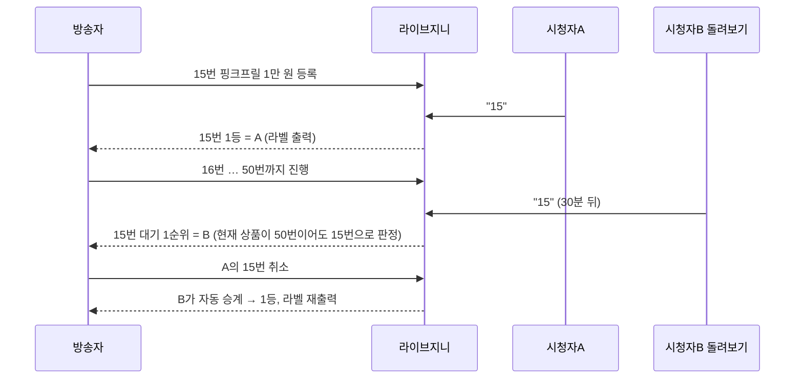

판정 규칙은 문서([DOMAIN_RULES](spec/DOMAIN_RULES.md))로 정했다. 판정·해석 사례 약 750개(파서 596·엔진 156)를 "실행 가능한 정답"(골든 시나리오)으로 만들어 바뀔 때마다 자동으로 검사한다. 판매자는 판매 규칙(대기 인원, 승계 방식, 채팅·문자 경합 정책)을 고를 수 있다.

#### 핵심 기능 ②: 업종 확장 — 옵션 댓글과 "확인 필요"

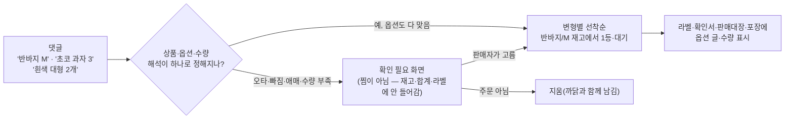

- **다육 기능이 먼저다**: 판매 방식 기본값은 "번호로만 받기"다. 옵션 인식은 판매자가 방송마다 "상품명·옵션도 받기"를 고른 방송에서만 켜진다. 번호 방송의 화면·판정·골든은 그대로다.
- **애매하면 주문이 아니다**: 자동 주문은 해석이 하나로 정해지고 옵션이 다 맞을 때만이다. 비슷한 말(오타)은 자동으로 맞추지 않고, 확인 필요 화면에 후보로만 보인다.
- **수량**: 남은 수량 이상이면 확정, 모자라면 일부만 확정하지 않고 확인 필요로, 다 팔렸으면 품절이다. 금액 = (상품 가격 + 선택지 가격 차이) × 수량, 정수 원이다.

#### 핵심 기능 ③: 라벨이 있어도 없어도 끝나는 정산, 택배까지

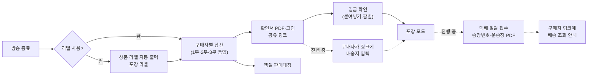

택배 자동 접수(T1)의 원칙: 정산 묶음 하나 = 택배 하나, 같은 묶음 두 번 접수 막기, 실패·일부 실패 다시 하기, 주소·연락처는 암호화 저장하고 로그에 남기지 않는다. 1차 택배사(우체국 계약택배·CJ대한통운·롯데·한진 또는 접수 대행)는 개발 중에 정한다. B1 라벨(폭 50mm)이 운송장 규격에 맞지 않으면 운송장은 PDF로 일반 프린터에서 뽑는다.

#### 핵심 기능 ④: 유튜브·인스타그램·틱톡 한 화면

| 플랫폼 | 댓글 수집 | 감사 메시지 | 구매자 구분 | 비고 |
|---|---|---|---|---|
| 유튜브 | 공식 API(`liveChatMessages.streamList`, 실시간 스트리밍) | 라이브 채팅에 자동 게시 | 채널 고유 ID(닉네임이 바뀌어도 같은 사람) | 구글 민감 권한 앱 심사 필요. 채팅 원문 30일 봉인 |
| 인스타그램 | 공식 API(`live_comments` 웹훅) | 공개 답글이 안 돼서 DM으로 1회 감사 | 인스타그램 사용자 ID | 메타 앱 심사·비즈니스 인증 필요 |
| 틱톡 | 공식 댓글 API가 없다. 판매자가 동의하면 읽기 전용 베타로 받는다 | 보내지 않는다(읽기만) | 숫자 사용자 ID | 기본 꺼짐, 끄기 스위치, 연결이 막히면 댓글 붙여넣기로 대체. 상용 출시 전 법률 검토 |
| 문자 | 판매자·보조자가 입력(자동 수집은 계획) | 해당 없음 | 전화번호(암호화, 뒤 4자리만 표시) | 채팅과 같은 판정 체계 |

세 플랫폼에 동시에 방송해도 댓글이 한 상품 보드로 모인다. 판정 순서는 서버에 도착한 순서다.

### 2.3 시장분석

> 조사 기준일 2026-10-20(개정 2026-10-22). 숫자 뒤의 [n]은 [부록 A. 출처](#부록-a-출처)의 번호다. "추정"은 공개 자료를 바탕으로 한 계산이나 판단이다. 개정에서 새로 넣은 업종 확장 숫자는 공개 집계가 없어 모두 계산식과 함께 "추정"으로 표시했다.

#### ① 기존 유사 서비스

**국내: 다육 라방에 맞춘 도구는 사실상 하나뿐이고, 범용 도구는 주문서 링크형이다**

| 유형 | 서비스 | 방식 | 요금(공개 자료) |
|---|---|---|---|
| 다육 특화 AI | **도움봇** [1] | 유튜브 채팅의 찜 번호를 받아 라벨을 즉시 인쇄한다. 1~3부를 통합하고 구매자별 명세서 문자에 계좌를 붙여 보낸다. AI 모드는 방송자의 말에서 가격·이름을 정리하고, 보급형은 사람이 채팅창에 직접 친다 | AI 모드 하루 4만 원(3시간까지) + 1시간마다 1만 원, 보급형 하루 2만 원. 전용 프린터 구매 45만 원(시중가 55만 원 − 보조 10만 원) 또는 협력 유튜버 방송일에 한해 하루 3만 원 대여. 전용 라벨 100장 1만 원만 써야 하고, 어기면 계약이 끝난다 |
| 범용 댓글 주문 | 라이브챗오더 [3] | PC 크롬 확장으로 유튜브·틱톡·인스타 채팅을 수집한다. 팝빌 계좌 연동, 포장 모드, 송장 엑셀 | 월 20만 원 |
| | 라방ERP + 위잉치킨 [4] | 틱톡·유튜브 채팅을 동시에 수집한다. 번호표 라벨(기종은 업체 맞춤), 알림톡, 통장 매칭, 송장 | 설치 80만 원 + 월 18.7만 원(둘 다 쓸 때) |
| | 라이브마켓 [5] | 유튜브·틱톡·밴드. 주문서·결제 요청 알림톡, 무통장 입금 반영 | 월 5.9만 원 + 결제액 2% |
| | 챗오더 [9] | 유튜브에서 주문 링크·QR로 유도한다. 알림톡, 송장 | 월 0원(베이직) / 월 5.5만 원 + 판매 수수료 2% |
| | 셀리브 [6] | 주문서 링크 방식. 여러 플랫폼, 주문·정산 엑셀 | 월 3.3만 원부터 |
| | 라이브버디 [10] | 안드로이드 앱. 방송 중 버튼을 눌러 직접 기록하고 정산서 링크를 보낸다 | 월 3.9만 원 |
| | LiveOrder [7], Moaply [8], Sellvit [13], 주문하마 [14] | 크롬 확장 / PC 설치형 / 채팅 AI 응대 / 카톡·밴드 댓글 수집 | 공개 안 됨 |
| 자사몰형 송출 | 모루라이브 [11], 샌드라이브 [12] | 자체 송출 쇼핑몰 + 정산서·알림톡 | 샌드라이브 구축형 1,200만 원 + 월 30만 원 또는 수수료 3.8% |
| 입점형 | 네이버 쇼핑라이브, 그립, 카카오, 엑스플랜트(식물 마켓) [15][16] | 플랫폼 안에서 송출·결제한다. 고객은 플랫폼 소유다 | 판매 수수료 3~7.7% + 결제 수수료(블로그 비교 자료) |
| 사람 | **전산·찜 스티커 알바** [18]~[23] | 다육 라방은 진행자, 찜 스티커 쓰기, 정산, 포장으로 역할을 나눈다. 라방 보조 구인은 노트북으로 주문 받아 적기, 엑셀 주문서, 입금 확인 | 회당 4.5만 원 ~ 일급 15만 원(구인 공고 5건). 업계에서는 "기본 10만 원" |

**해외: "댓글로 파는" 도구 시장이 이미 크다**

| 서비스(국가) | 방식 | 요금 | 규모 신호 |
|---|---|---|---|
| **CommentSold**(미국) [24][25] | 페이스북·인스타·틱톡 댓글로 인보이스를 자동 발송한다. 대기열, 라벨 일괄 출력, 바코드 포장 검수, 같은 고객 주문 합치기 | 월 $149~999 + 매출의 4~6% | 판매자 6,000명 이상, 직전 12개월 GMV 10억 달러 이상(2021, Permira 투자 발표) |
| SHOPLINE(싱가포르·대만) [26] | "키워드+1" 댓글 → DM 장바구니, 재고 잠금 | 비공개 | 판매자 70만 이상(회사 주장) |
| SoldLive(Shopify 앱) [27] | 상품 번호 댓글 → 인보이스, "먼저 잡은 사람이 획득", 대기열 | 월 $35~300 | — |
| Selmo(폴란드) [28] | 댓글 주문 → 결제 링크, 택배 라벨·인보이스 | 월 $89부터 | — |
| Whatnot(미국) [29][30] | 자체 앱 라이브 경매. 2023년 홈&가든 카테고리를 연 뒤 **식물 매출 8배, 식물 판매자 3배**(2024) | 판매 수수료 8% + 결제 수수료 | 2025년 GMV 80억 달러, 기업가치 200억 달러(2026.8) |
| Palmstreet(미국) [30][31] | 희귀 식물 라이브 경매 마켓. 2년 동안 주문 300만 건, 식물 한 개체를 2.6만 달러에 판매 | 수수료 3.9~5.9% | 누적 투자 2,500만 달러 |

**정리**
- 해외에서는 "판매자 자기 채널 + 댓글 주문 도구"(CommentSold형)가 하나의 산업이다. 의류·잡화 판매자가 중심이고, 키워드·옵션 댓글과 택배 라벨까지 묶는 것이 표준이다 [24][26][28]. 메타가 페이스북 라이브 쇼핑(2022.10)과 인스타 라이브 상품 태그(2023.3)를 끝낸 뒤 이런 외부 도구의 수요가 더 커졌다 [32][33].
- 국내에는 이 유형이 아직 작고 흩어져 있다. 크롬 확장 도구 중에는 사용자가 수십 명 이하인 곳도 있고, 장애 공지가 걸린 곳도 있다 [7][3]. **식물·다육 특화 판매자 도구는 국내외 모두 사실상 비어 있고**, 국내 범용 도구는 옵션 댓글을 선착순으로 판정하지 않고 주문서 링크로 돌린다.

#### ② 시장 동향 및 규모

**동향**

| 동향 | 근거 | 라이브지니에 주는 뜻 |
|---|---|---|
| 라이브커머스가 계속 커진다 | 국내 거래액 2조(2022) → 3조(2023) → 3.5조(2024) → **4.7조 원(2025, +35%)**. 방송당 매출 998만 원(+61%) [34] | 방송 1회당 처리할 주문이 늘어 자동화 필요가 커진다 |
| SNS 판매자가 빠르게 는다 | 국세청 SNS마켓업 등록 4,685명(2021) → 1만 4,160명(2025.8), 약 3배 [35]. 그립 셀러 4.3만 명(2024.10) → 5.7만 명(2026.6) [36] | 1인·소규모 판매자 시장이 두꺼워진다 |
| 유튜브가 판매 채널이 됐다 | 유튜브 쇼핑 2024.6 국내 출시, 가입 크리에이터 2.5만 명 이상(2025.7) [37] | 유튜브 라방이 주 무대인 다육 시장과 맞는다 |
| 틱톡샵은 국내에 없다 | 틱톡은 2026년 국내 출시를 하지 않는다고 밝혔다 [38] | 틱톡 라방 판매자는 댓글 주문을 밖에서 처리해야 한다 → 외부 도구 수요 |
| 다육은 유튜브가 가장 남는 판로다 | 다육 판매액 643억 원(2022) [39]. 경기도가 재배면적·농가의 60% 이상 [40]. 채널별 마진율 유튜브 43.5% > 스마트스토어 37.5% > 오프라인 14.5% [39] | 농가가 유튜브 라방으로 옮겨 갈 이유가 있다 |
| 다육 라방은 실제로 팔린다 | 경기도농업기술원 실증(2025): 4시간 넘는 라이브 4회, 회당 170~270만 원, 합계 800만 원 [40]. 다육 판매 유튜버 월 6~7회(농가 직접) ~ 19~62회(전문 유튜버) 방송(2022) [39] | 방송 1회당 주문 수십~수백 건이 생긴다 |
| 판매자가 고령이다 | 농가 경영주 평균 67.7세, 60세 이상 78.8%(2025 농림어업총조사 잠정) [41]. 보고서는 "고령화로 온라인 매체 활용이 어렵다"고 적었다 [39] | 설치 없는 웹, 쉬운 화면, 간편 로그인이 필수다 |
| 반려식물 시장 | 반려식물 시장 2조 4,215억 원(식물 자체 1조 1,856억 원), 반려식물 인구 1,745만 명(2025, 농촌진흥청) [42] | 다육 다음 확장 시장(관엽·희귀 식물·화분)이 크다 |
| 라방 소상공인은 다업종이다 | 온라인 판매 소상공인 81.7만 명 [46]. 정부 라이브커머스 제작 지원 연 1,300개사 [49]. 업종별 라방 판매자 비중은 공개 집계가 없다(추정 필요) | 다육 하나로는 시장이 작다. 옵션·수량·택배를 갖추면 식품·의류·잡화 판매자까지 같은 제품으로 받는다 |
| 해외는 더 크다 | 세계 라이브커머스 1,729억 달러(2025) → 2033년 2.5조 달러 전망(연 41%) [43]. 동남아 콘텐츠 커머스 497억 달러(2025, 이커머스의 32%) [44] | 댓글 주문 문화권(대만·동남아)으로 해외 확장 여지 |

**TAM · SAM · SOM**


| 구분 | 정의 | 2025 | 2031(출시 5년차) | 계산 근거 |
|---|---|---|---|---|
| **TAM**(전체 시장) | 국내 라이브커머스 전체 거래액 | **4.7조 원** | **약 10.9조 원** | 2025년 실제 집계 4.7조 원 [34]. 2031년은 연 15% 성장 가정이다(4.7조 × 1.15⁶ ≈ 10.9조). 2025년 실제 성장률은 35%였지만, 과거 전망치가 실제보다 20~30% 높았던 점을 고려해 낮춰 잡았다. 집계가 플랫폼 밖 SNS 라방을 다 담지 못해, 실제 TAM은 이보다 크다(하한값). 참고로 SNS 세포마켓 전체는 15조 원 이상으로 추정된 적이 있다(2019) [45] |
| **SAM**(유효 시장) | 플랫폼 밖 SNS 라방(유튜브·인스타·틱톡)에서 댓글로 주문받는 소상공인 판매자(식품·화분·의류·잡화·다육 등 전 업종)의 거래액 | **약 2.1조 원** | **약 4.9조 원** | 판매자 약 3만 명 × 판매자당 연 거래액 0.7억 원(아래에서 위로 계산). 판매자 수는 세 근거의 가운데 값이다. 온라인 판매 소상공인 81.7만 명 [46]의 3~5%인 2.5만~4.1만 명, SNS마켓업 등록 1.4만 명(하한) [35], 그립 셀러 5.7만 명(참고) [36]. 연 거래액은 SNS마켓업 평균 수입 0.99억 원·하위 10% 0.41억 원 [47]과 다육 실증 회당 170~270만 원 [40] 사이로 잡았다. 2031년은 TAM과 같은 성장률이다 |
| **SOM**(수익 시장) | 라이브지니가 실제로 처리할 거래액 | — | **약 5,600억 원**(추정) | 유료 판매자 7,000명 × 연 거래액 0.8억 원. 2031년 SAM의 약 11%다. 처음 기획(6,000명·4,800억 원)보다 늘려 잡은 까닭: 상품 옵션이 이미 완성돼 식품·의류 판매자 진입이 2년 앞당겨졌고(처음 계획은 4년차), 택배 자동 접수·간편 로그인이 방송이 잦은 업종의 이탈 요인을 줄인다(추정). 비교 사례: CommentSold는 판매자 6,000명으로 연 GMV 10억 달러(약 1.3조 원)를 처리했다(2021) [25] |

**SAM 업종별 구성(2025, 추정)**

업종별 라방 판매자 비중은 공개 집계가 없다. 아래는 확장 순서를 정하려는 가정이며, 파일럿·판매자 인터뷰로 고친다.

| 업종 | 판매자 비중(가정) | 판매자 수 | 거래액(= 2.1조 원 × 비중) | 라이브지니에 필요한 것 |
|---|---|---|---|---|
| 식품·농수산물 | 40% | 약 1.2만 명 | 약 8,400억 원 | 수량·중량·맛 옵션, 택배 접수 |
| 의류·잡화 | 35% | 약 1.05만 명 | 약 7,350억 원 | 사이즈·색 옵션, 변형별 재고, 택배 접수 |
| 식물(다육·화분·꽃) | 5% | 약 1,500명 | 약 1,050억 원 | 번호 선착순·라벨(완성). 반려식물 중 식물 자체 1조 1,856억 원 [42]의 약 9% |
| 기타(휴대폰 케이스·수공예·관상어 등) | 20% | 약 6,000명 | 약 4,200억 원 | 기종 옵션, 업종 템플릿 |
| **합계** | 100% | 약 3만 명 | **약 2.1조 원** | — |

**SOM 단계별 목표(연말 기준 연 환산, 추정)**

| 연도 | 단계 | 유료 판매자 | 처리 거래액(SOM) = 판매자 × 0.8억 원 | 근거 |
|---|---|---|---|---|
| 2027(1년차) | 다육 시장 + 화분·식품 초기 | 300명 | 240억 원 | 다육 라방 판매자 200~400명 추정(분화 농가 2,409호 [48] 중 다육 비중·라방 운영 비율로 계산 + 전문 유튜버) 중 일부 + 옵션 기능으로 받는 화분·식품 판매자 |
| 2028(2년차) | 식품·의류 확장 | 1,200명 | 960억 원 | 인스타·틱톡 동시 방송, 라벨 없는 판매자, 택배 자동 접수 |
| 2029(3년차) | 소상공인 라방 전반 | 3,000명 | 2,400억 원 | 의류·잡화·수공예. 정부 라이브커머스 지원사업 연계(연 1,300개사 제작 지원 [49]) |
| 2030(4년차) | 국내 확산 | 5,000명 | 4,000억 원 | 업종별 템플릿, 문자 자동 수집 |
| **2031(5년차)** | 국내 확산 + 해외 시작 | **7,000명** | **5,600억 원** | SAM 판매자의 약 15~20%(2031년 SAM 판매자 3.5만~4.7만 명 가정), 거래액 기준 약 11% |

> 거래액(GMV)은 판매자가 라이브지니로 처리하는 판매 금액이다. 라이브지니의 매출이 아니다. 매출은 [3.3 수익모델](#33-수익모델bm)에서 따로 계산했다(2031년 연 환산 약 32억 원). 판매자당 연 거래액은 업종마다 차이가 크다. 파일럿 판매자 인터뷰(월 방송 횟수·회당 주문 수·객단가)로 다시 확인한다.

#### ③ 경쟁 제품 비교 및 차별화 요소

**기능 비교**(○ 있음, △ 일부·수동, × 없음, ? 공개 자료에 없음)

| 기능 | **라이브지니** | 도움봇 | 라이브챗오더 | 라방ERP | 라이브마켓 | 셀리브 | 사람 스태프 |
|---|---|---|---|---|---|---|---|
| 프린터 | **가진 것 그대로**(B1·Marklife·바우아토·PNG/PDF) | 전용 기종·전용 라벨 강제 | ? | 업체 맞춤 | ? | ? | 손글씨 |
| 라벨 켜기/끄기 | **○** | ? | — | ? | — | — | — |
| 음성 AI 상품 등록 | **○**(제안 카드 + 사람 확인) | ○ | × | × | × | × | 사람이 받아 적음 |
| 번호 선착순 자동 판정 | **○**(대기·승계·품절) | ○ | △(닉네임 클릭) | ? | ×(링크 주문) | ×(링크 주문) | 눈으로 |
| **늦은 찜(지난 번호)** | **○** | ×(현장 확인) | ? | ? | ? | ? | 놓치기 쉬움 |
| 문자 찜 경합 규칙 | **○**(도착순/실제 시각순) | ? | ? | ? | ? | ? | 감으로 |
| **옵션 댓글 인식·변형별 재고** | **○**(애매하면 확인 필요) | × | ? | ? | △(주문서에서 고름) | △(주문서에서 고름) | 눈으로 |
| 1~3부 회차 통합 | ○ | ○ | ○ | ○ | ○ | ○ | 엑셀 |
| 영수증 PDF·그림·공유 링크 | **○** | △(문자 명세서) | △(정산서) | △(알림톡) | △(알림톡) | △ | 수기 |
| 엑셀 판매대장 | ○ | ? | ○ | ○ | ○ | ○ | 수기 |
| 입금 확인 | **○**(붙여넣기 + 팝빌, 확인 대기열) | ? | ○(팝빌) | △(방식 비공개) | △(방식 비공개) | ? | 눈으로 |
| 택배 접수·송장 | 진행 중(일괄 접수·운송장 PDF·조회 안내) | ? | △(송장 엑셀) | △(송장) | ? | ? | 손으로 |
| 감사 메시지 자동 게시 | **○**(유튜브 채팅, 인스타 DM) | ? | ? | ? | △(채팅 알림) | ? | 사람이 침 |
| 플랫폼 | **유튜브·인스타·틱톡(베타) 동시** | 유튜브 | 유튜브·틱톡·인스타 | 유튜브·틱톡 | 유튜브·틱톡·밴드 | 여러 플랫폼 | — |
| 판정 근거 기록(분쟁 대응) | **○**(모든 입력 기록·재생 검증) | ? | ? | ? | ? | ? | × |
| 설치 | **없음(웹·PWA)** | 프린터 설치 | 크롬 확장 | 설치비 있음 | 웹 | 웹 | — |
| 요금(월 2회 방송 기준) | **정액제 월 2.9만 원 또는 방송 일권 회당 9,900원**(제안가) | 회당 5만 원 안팎(4시간) + 프린터 | 월 20만 원 | 월 18.7만 원 + 설치 80만 원 | 월 5.9만 원 + 2% | 월 3.3만 원 | 회당 4.5만~15만 원 |

**포지셔닝 맵**

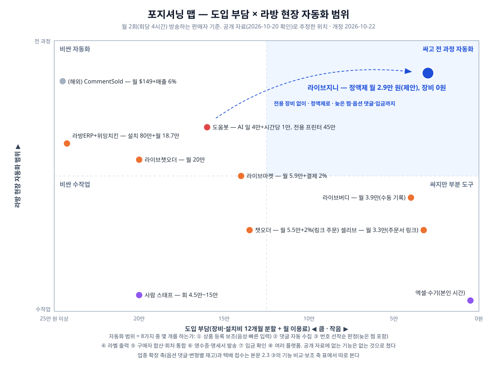

| 위치 | 서비스 | 해석 |
|---|---|---|
| 왼쪽 위(비싼 자동화) | 도움봇, 라방ERP, 라이브챗오더, (해외) CommentSold | 자동화는 되지만 장비·설치비·월 요금이 무겁다. 월 2회 방송하는 농장에는 과하다 |
| 오른쪽 아래(싸지만 부분 도구) | 셀리브, 라이브버디, 챗오더 | 싸지만 링크 주문이나 수동 기록이다. 라방 관행인 "댓글 선착순"과 다르다 |
| 왼쪽 아래(비싼 수작업) | 사람 스태프 | 회당 비용이 들고, 실수가 난다 |
| **오른쪽 위(싸고 전 과정 자동화)** | **라이브지니** | 장비 0원, 월 2.9만 원(제안가)으로 등록·판정·라벨·영수증·입금·포장까지 한다. 이 칸은 비어 있다 |

**업종 확장 축에서 본 위치**(포지셔닝 맵의 보조 축)

| | 댓글 선착순을 자동 판정하지 않음 | 댓글 선착순을 자동 판정함 |
|---|---|---|
| **여러 업종(옵션·수량)** | 범용 라방 도구(라이브마켓·셀리브·챗오더) — 주문서 링크에서 옵션을 고른다 | **라이브지니** — 옵션 댓글을 변형별로 판정하고, 애매하면 확인 필요로 |
| **한 업종(번호만)** | 사람 스태프·엑셀 | 도움봇 — 다육 번호 찜만 |

**차별화 요소와 혁신 요소**

| # | 차별화 | 왜 중요한가 | 경쟁사 상황 |
|---|---|---|---|
| 1 | **프린터 자유 + 라벨 켜기/끄기** | 판매자마다 프린터가 다르다(B1, Marklife X2 등). 라벨을 안 쓰는 판매자도 있다 | 도움봇은 45만 원 전용 프린터와 전용 라벨에 묶여 있다. NIIMBOT B1은 시중 3~6만 원대다 [50] |
| 2 | **늦은 찜·보류 찜·문자 찜 경합까지 판정** | 돌려보기 시청자의 주문은 그대로 매출이다. 판정 근거가 기록으로 남아 분쟁에 대응한다 | 조사한 모든 서비스의 공개 자료에 언급이 없다 |
| 3 | **옵션 댓글을 선착순으로, 애매하면 사람에게** | 의류·식품 라방도 "먼저 쓴 사람이 산다"를 지킨다. 오타를 자동으로 맞춰 엉뚱한 사람에게 파는 사고를 막는다 | 범용 도구는 주문서 링크로 돌린다. 다육 도구는 번호만 받는다 |
| 4 | **정액제(월) + 방송 일권·주문 건권** | 월 2회 방송 농장은 월 회원권을 원한다. 가끔 방송하는 판매자는 그날만 산다. 방송 중 이용권이 떨어져도 끝까지 판다 | 도움봇은 일당·시간제다. 범용 도구는 월 3.3만~20만 원 또는 매출 수수료다 |
| 5 | **방송 후 10분 정산, 택배까지** | 확인서 PDF·그림·공유 링크, 엑셀, 입금 확인, 포장 모드, 택배 일괄 접수(진행 중) | 라방 도구 문의의 79%가 방송 뒤 처리에 관한 것이었다(모루라이브 379건 분석) [11] |
| 6 | **3개 플랫폼 동시 방송을 한 보드로** | 유튜브·인스타·틱톡에 함께 내보내는 판매자가 는다 | 다육 특화 도구는 유튜브만 지원한다 |
| 7 | **"AI는 입력, 규칙은 판정" 구조** | AI의 편리함과 판정·금액의 정확성을 함께 얻는다 | 음성 AI는 도움봇만 있다. 판정 규칙과 근거는 공개되지 않았다 |
| 8 | **고령 판매자용 쉬운 웹** | 농가 경영주 평균 67.7세. 시작 마법사, 연습 모드, 간편 로그인(진행 중) | 크롬 확장·PC 설치형·안드로이드 전용 앱이 많다 |
| 9 | **검증된 신뢰성** | 메인에 넣기 전 7단계 전체 검증(단위 약 5,400·골든 약 750·공격 약 1,280·브라우저 약 620 시험)으로 판정·금액을 고정했다 | 공개된 검증 체계가 없다 |

#### ④ 프로젝트 개발 타당성

| 관점 | 판단 | 근거 |
|---|---|---|
| **기술** | 높음 | 핵심 기술을 이미 구현했다. 브라우저 → NIIMBOT B1 직접 출력(Web Bluetooth), 유튜브 실시간 채팅 수집(streamList), 순수 판정 엔진, 옵션·변형 재고·댓글 옵션 인식, PDF·그림·엑셀, 음성 추출이 동작한다. 개발 시작 5일(2026-10-18~22) 만에 24개 묶음과 옵션 확장을 메인에 넣었다. 프린터·플랫폼·음성·로그인·택배사는 어댑터 구조라 확장 비용이 작다. 남은 위험은 실물 확인(B1 실출력, 실제 유튜브 방송, 실제 목소리)이다 |
| **시장** | 높음 | 판매자는 이미 스태프(회 4.5만~15만 원)와 AI 서비스(일 2~6만 원)에 돈을 낸다. 다육 특화 경쟁자는 하나이고 초기 단계다(유튜브 채널 구독자 6명 [2]). 해외에서는 같은 유형(CommentSold)이 이미 큰 산업이다. 옵션 기능으로 SAM의 식물 밖 약 95%(추정)에 들어갈 수 있다 |
| **경제** | 높음 | 서버 1대 + 관리형 DB로 시작한다. 유튜브 API는 사용료가 없다(할당량만 있음). 기본 음성 인식은 브라우저 내장이라 무료다. 판매자가 늘어도 추가 비용이 작다. 입금 연동·택배 접수는 실비를 받는다 |
| **운영·법** | 보통(대응 계획 있음) | 사업자·통신판매업은 갖췄다. 외부 심사·계약·법률 검토가 남았다. 아래 위험 표와 [사장님 할 일 안내](OWNER-GUIDE.md)로 관리한다 |

**주요 위험과 대응**

| 위험 | 영향 | 대응 |
|---|---|---|
| **KT '지니' 계열 상표와의 유사성** | "라이브지니"를 쓰지 못하거나 이의 신청을 받을 수 있다 | 키프리스 검색과 변리사 확인을 먼저 한다(소프트웨어·온라인 서비스 류). 확인 전까지 "가칭"으로 쓰고, 막히면 대안 이름으로 바꾼다. 도메인 livegenie.kr·livegenie.co.kr은 확보 가능하고 livegenie.com은 이미 등록돼 있다 |
| 유튜브 API 할당량(프로젝트 단위, 기본 하루 1만 단위. 감사 메시지 1건 = 20단위) | 판매자가 늘면 감사 메시지가 막힌다 | 할당량 증설 감사를 판매자를 여럿 받기 전에 신청한다. 감사 메시지는 선택 기능이고 실패해도 판매 기록은 안전하다(발송함) |
| 구글 OAuth 앱 검증(유튜브 민감 권한) | 검증 전에는 테스트 사용자 100명, 연결이 7일마다 만료된다 | 개인정보처리방침·도메인·데모 영상을 준비해 출시 전에 신청한다. 구글 로그인은 유튜브 권한을 묻지 않아 심사가 가볍다 |
| 인스타그램 웹훅 조건 | 앱 심사(고급 권한)·비즈니스 인증 전에는 라이브 댓글 웹훅이 오지 않을 수 있다 | 유튜브로 먼저 출시하고, 인스타는 심사 통과 뒤 연다 |
| 틱톡 공식 API 없음 | 약관 위험, 연결 차단, 장난 도배 [17] | 읽기 전용 베타, 기본 꺼짐, 판매자 동의, 운영자 끄기 스위치, 댓글 붙여넣기로 대체한다. 상용 출시 전에 법률 검토를 받는다 |
| 이용권의 선불전자지급수단 해당 여부 | 해당하면 등록·발행 한도 문제가 생긴다 | 원 단위 충전금·포인트·출금을 만들지 않았다(D-N5-02). 정량 이용권(일권·건권·장권)이 해당하는지 법률 검토에서 꼭 묻는다 |
| 개인정보 수탁자 지위 | 구매자 정보는 판매자가 모으고 라이브지니가 맡아 처리한다 | 약관에 처리 위탁 조항, 개인정보처리방침 공개. 전화번호·주소·토큰은 암호화하고 로그에 남기지 않는다. 서버는 국내 리전을 권장(국외 이전 고지 부담) |
| 간이과세자의 증빙 발급 | 매출 규모에 따라 세금계산서 발급 가능 여부가 달라 판매자(사업자)의 증빙 요구에 못 맞출 수 있다 | 세무 확인 뒤 필요하면 일반과세자 전환을 검토한다. 계좌이체 결제의 증빙 요청은 이미 기록하도록 만들었다(D-N5-11) |
| 라벨프린터 제조사 정책 | 정품 라벨 요구, 상업 사용 | 정품 라벨 안내. NIIMBOT 국내 총판에 상업 사용 동의를 문의한다. PNG·PDF 대체 경로가 늘 있다 |
| 택배사 계약·운송장 양식 | 택배사마다 API·계약 조건·양식 승인이 다르다 | 택배사 어댑터 + 가짜 택배사로 먼저 만들고, 1차 택배사 하나와 계약한다. 접수가 막혀도 송장 손 기록이 늘 된다 |
| 판매자 디지털 역량 | 도입 포기 | 시작 마법사, 리허설, 연습 모드, 현장 설치 지원, 간편 로그인 |
| 경쟁사 가격 인하 | 가격 우위 축소 | 장비 자유·늦은 찜·옵션 판정·입금·택배까지의 기능 차이와 신뢰성(검증 체계)으로 경쟁한다 |

### 2.4 시스템 구성도

#### 사용 기술(기술 자원)

| 영역 | 기술·플랫폼 | 고른 이유 |
|---|---|---|
| 언어 | **TypeScript**(전 구간) | 판정 엔진 하나를 서버와 브라우저가 함께 쓴다 |
| 웹 화면 | React 19, Vite, **PWA**(휴대폰 홈 화면 설치) | 설치 없이 PC·휴대폰에서 같은 화면을 쓴다 |
| 서버 | Node.js LTS, Hono, Drizzle ORM | 채팅 수집처럼 오래 연결된 작업이 있어 상시 서버가 필요하다 |
| 데이터베이스 | **PostgreSQL**(관리형). 시험에는 PGlite(내장 Postgres)를 쓴다 | 이벤트 기록·트랜잭션·백업이 안정적이다 |
| 실시간 반영 | 서버 전송 이벤트(SSE) | 한 기기에서 바꾸면 1초 안에 모든 기기에 반영된다 |
| 판정 엔진 | `packages/core`: 시계·난수·입출력이 없는 **순수 함수**. 옵션 모델·변형 재고·수량·댓글 옵션 인식(`parseOptionComment`)·확인 필요 대기열 포함 | 같은 기록이면 언제나 같은 판정·금액이 나온다. 기록을 다시 돌려 검증할 수 있다 |
| 라벨 | `packages/label`: 캔버스 1비트 그림, 한글 글꼴(Pretendard). `packages/printer`: NIIMBOT(niimbluelib)·Marklife·바우아토 프로토콜 | 미리보기 그림이 곧 출력 그림이다. 프린터는 어댑터로 붙인다 |
| 프린터 연결 | **Web Bluetooth / Web Serial**(크롬·엣지·안드로이드 크롬) | 드라이버·설치 없이 브라우저가 직접 출력한다 |
| 문서 | `packages/documents`: pdf-lib(PDF), exceljs(엑셀), 그림(PNG) | 확인서·명세서 PDF·그림, 엑셀 판매대장, (진행 중) 운송장 PDF |
| 음성 | `packages/voice`: 크롬 Web Speech(무료). Deepgram·리턴제로 어댑터는 골격만 있다 | 기본은 비용 0원. 정확도가 모자라면 클라우드 엔진으로 바꾼다 |
| 외부 API | YouTube Data API v3(OAuth, gRPC `streamList`), Instagram Platform API(웹훅·DM), TikTok 라이브(읽기 전용 베타), 팝빌 계좌조회, 포트원 V2 + 토스페이먼츠, (진행 중) 구글·카카오·네이버 OAuth 로그인, 택배사 접수 API | 공식 API를 먼저 쓰고, 모두 어댑터 뒤에 둔다. 시험·연습 모드는 127.0.0.1 가짜 서버 |
| 보안 | 전화번호·주소·토큰은 AES-GCM으로 암호화한다. 비밀번호는 scrypt로 해시한다. 판매자별 데이터를 격리하고 채팅 글·닉네임은 항상 이스케이프한다. 간편 로그인은 state(+PKCE)·돌아오는 주소 정확히 일치 | 개인정보·다중 판매자 운영 |
| 품질 | Vitest, fast-check(속성 기반 시험), Playwright(브라우저 E2E), 골든 시나리오 | 판정·금액을 "예시 + 무작위 속성" 두 겹으로 고정한다 |
| 배포 | 컨테이너 1개 + 관리형 PostgreSQL + HTTPS 도메인(국내 리전 권장) | 단순하고 운영비가 싸다 |

#### 전체 구성도


| 층 | 구성 요소 | 관계 |
|---|---|---|
| ① 판매자 기기 | PC·안드로이드·아이폰 브라우저, 마이크 | 서버에 HTTPS로 입력하고, SSE로 1초 안에 같은 화면을 받는다. 라벨프린터에는 브라우저가 블루투스로 직접 출력한다 |
| ② 라벨프린터(선택) | NIIMBOT B1, Marklife, 바우아토, 그 밖의 프린터(PNG·PDF) | 서버를 거치지 않는다. 라벨을 끄면 쓰지 않는다 |
| ③ 서버 | 입력(웹 API·로그인·댓글 수집기·입금 매칭) → 입력 우선 기록 → 판정 엔진(옵션 인식 포함) → 조회 표·실시간 푸시·문서 생성·발송함·요금·택배 접수 | 모든 입력이 한 길(기록 → 판정)을 지난다. 그래서 어느 경로로 들어와도 같은 규칙으로 판정된다 |
| ④ 외부 서비스 | 입력 원천(유튜브·인스타·틱톡·팝빌·구글/카카오/네이버 로그인), 발송·결제(유튜브 채팅·인스타 DM·포트원·토스·택배사·클라우드 음성) | 모두 어댑터 뒤에 있다. 하나가 멈춰도 판매 기록은 안전하다 |
| DB | PostgreSQL | 이벤트 기록과 조회용 표, 매일 백업. 기록을 다시 돌려 판정을 검증한다 |

#### 한 번의 찜이 처리되는 길

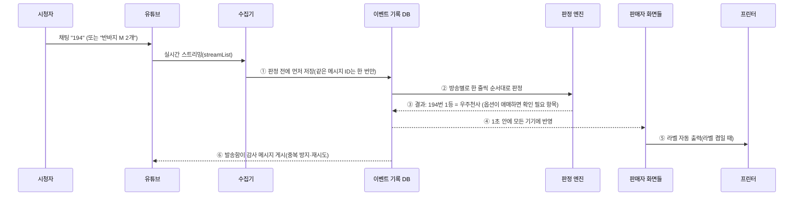

#### 간편 로그인과 택배 접수가 붙는 자리(진행 중)

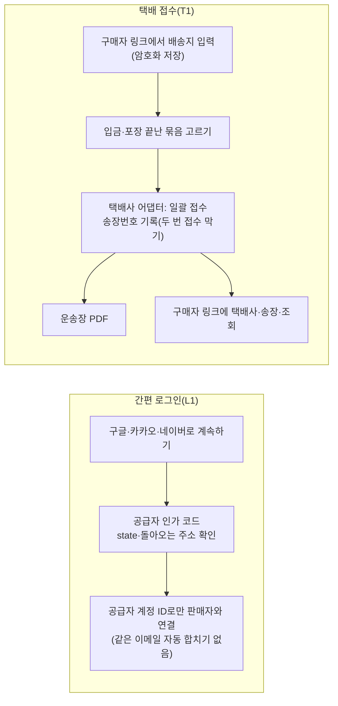

#### 구성 요소의 관계와 설계 원칙

| 원칙 | 내용 | 효과 |
|---|---|---|
| 입력 우선 기록 | 채팅·문자 찜·조작은 판정하기 **전에** 먼저 저장한다. 같은 메시지 ID는 DB 제약으로 한 번만 저장한다 | 서버가 꺼져도 입력을 잃지 않는다. 중복 수신을 막는다 |
| 순수 판정 엔진 | `apply(상태, 이벤트) → (새 상태, 효과)`. 시간도 이벤트로 받는다 | 같은 기록 → 같은 결과. 분쟁이 나면 기록을 다시 돌려 증명한다 |
| 정수 원 | 모든 금액(단가·가격 차이·수량 곱·배송비·할인)을 정수 원으로 계산한다. 소수가 생기는 연산은 쓰지 않는다 | 반올림 오차로 합계가 틀리지 않는다 |
| 방송별 직렬 처리 | 같은 방송의 이벤트는 한 줄로 처리한다 | 여러 기기가 동시에 입력해도 중복 판매가 날 수 없다 |
| 발송함(outbox) | 라벨 출력·감사 메시지는 판정 결과에서 나온 "할 일"로 따로 보낸다 | 외부 API가 실패해도 판매 기록은 안전하다. 재시도와 중복 방지가 된다 |
| 어댑터 | 프린터·채팅 플랫폼·음성 엔진·입금 원천·결제사·로그인 공급자·택배사를 모두 갈아 끼울 수 있다 | 장비·플랫폼 종속이 없다. 새 프린터나 새 플랫폼을 붙이는 비용이 작다 |
| 판매자 격리 | 모든 데이터를 판매자 단위로 나눈다 | 처음부터 다중 판매자 서비스로 운영할 수 있다 |

### 2.5 AI 활용 전략

#### AI 활용 목적

라이브 판매에서 사람이 가장 힘든 순간은 **방송하면서 동시에 받아 적어야 하는 순간**과 **방송 뒤 흩어진 정보를 맞추는 순간**이다. 라이브지니는 이 두 순간에 AI를 쓴다.

| 목적 | 적용 위치 | AI가 하는 일 | 판매자가 얻는 것 |
|---|---|---|---|
| ① 말로 상품 등록 | 방송 콘솔 | 방송자의 말 → 음성 인식 → 번호·품종·가격 추출 → 품종 이름 바로잡기 → 등록 제안 카드 | 키보드를 안 쳐도 된다. 받아 적는 스태프가 필요 없다 |
| ② 댓글 주문 인식 | 댓글 수집기·판정 엔진 | 수천 개 댓글에서 "주문(찜)"과 "그냥 말"을 가른다. 옵션 방송에서는 상품·옵션·수량을 읽는다. 애매한 댓글은 확인 필요로 보내고 후보를 붙인다 | 채팅을 눈으로 따라가지 않아도 된다. 업종이 달라도 같은 도구를 쓴다 |
| ③ 입금 매칭 | 정산 | 입금자명("김*희", "우주천사엄마")과 금액을 구매자·정산 묶음과 맞춘다. 확실한 1:1만 자동으로 확정하고 나머지는 확인 대기열로 보낸다 | 은행 앱과 엑셀을 대조하지 않아도 된다 |
| ④ (계획) LLM 보조 제안 | 확인 필요 화면 | 규칙이 정하지 못한 댓글에 "이렇게 읽은 것 같아요" 제안만 붙인다. 기본 꺼짐, 켤 때 댓글 글이 바깥 서비스로 간다는 동의를 받는다 | 확인 필요 줄을 더 빨리 처리한다 |
| ⑤ (계획) 판매 비서 | 방송 후 | 판매 요약(잘 팔린 품종·옵션·가격대·재구매 고객), 다음 방송 상품 추천, 구매자 문의 답변 초안 | 데이터를 근거로 다음 방송을 준비한다 |

#### 원칙: "AI는 입력을 돕고, 돈과 순서는 규칙이 정한다"

라이브 판매에서 틀리면 안 되는 것은 **누가 먼저 찜했는지**와 **얼마를 받아야 하는지**다. 이 둘은 확률로 답하는 AI에 맡기지 않는다.

| 층 | 누가 | 하는 일 | 왜 |
|---|---|---|---|
| 입력 | **AI** | 말·글·입금 내역을 구조화된 값(번호·품종·가격·옵션·수량·구매자 후보)으로 바꾼다 | 사람이 받아 적는 일을 줄인다 |
| 확인 | **사람(판매자)** | 제안 카드를 Enter 한 번으로 확정하고, 확인 필요 줄과 애매한 입금 매칭을 고른다 | AI가 틀려도 판매 기록에 들어가기 전에 막는다 |
| 판정 | **규칙 엔진** | 선착순·대기·승계·변형 재고·금액 계산을 결정적 규칙으로 처리한다 | 같은 기록이면 언제나 같은 결과다. 분쟁이 나면 기록을 다시 돌려 증명한다 |

AI가 확신하지 못하면 **틀린 값을 채우는 대신 칸을 비운다.** 예를 들어 "15번 16번 만 원"처럼 번호가 둘이면 번호를 비운다. 옵션 댓글도 같다. `반바지 엠`처럼 정한 선택지와 정확히 같지 않으면 자동으로 M으로 맞추지 않고 확인 필요로 보낸다. 빈칸은 판매자가 바로 보고 채울 수 있지만, 틀린 값은 지나치기 쉽기 때문이다.

#### 처리 과정 ①: 음성 상품 등록

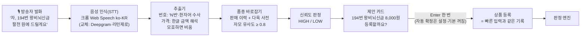

| 단계 | 처리 내용 | 예 |
|---|---|---|
| 음성 인식 | 크롬에 내장된 무료 한국어 인식을 기본으로 쓴다. 인식이 멈추면 다시 시작한다. 정확도가 모자라면 서버를 거쳐 클라우드 엔진(Deepgram·리턴제로)으로 바꾼다. 클라우드 엔진은 품종 사전을 키워드로 넣어 인식률을 높인다 | 중간 결과는 자막으로 보이고, 최종 문장만 추출에 쓴다 |
| 번호 추출 | `N번`만 번호로 본다. "한 번 더", "이번", "세 번째"는 번호가 아니다. 끊어 말한 번호("십 오번")는 비운다 | "백오번" → 105, "한 번 보세요" → 번호 없음 |
| 가격 추출 | 한글 금액(만오천 원·1.5만 원·팔천 원)을 정수 원으로 읽는다. 숫자만 있는 말("10000")은 가격으로 추측하지 않는다 | "만이천오백 원" → 12,500원 |
| 품종 바로잡기 | 판매자가 판 적 있는 품종(최근 것 먼저) + 기본 다육 사전에서 자모 단위로 가장 가까운 이름을 찾는다. 0.8 이상만 바로잡는다 | "핑크 푸릴" → 핑크프릴, "나울" → 라울 |
| 신뢰도 | 번호·품종·가격이 모두 있고 품종이 사전과 정확히 같으면 HIGH. 그 밖에는 LOW | HIGH일 때만 자동 확정이 가능하다(설정) |
| 사람 확인 | 카드를 Enter 한 번으로 확정한다. 이미 있는 번호면 "고칠까요?"로 묻는다 | 잘못 등록해도 5초 안에 되돌릴 수 있다 |

- 이 추출 규칙은 실제 발화 사례를 "정답 시험"(골든 시나리오)으로 고정했다. 규칙을 바꾸면 자동으로 다시 검사한다.
- 개인정보: 인식 문장은 그 브라우저 탭에만 있고 서버에 저장하지 않는다. 음성이 구글 인식 서버로 간다는 안내를 켤 때 보여 준다.
- 음성은 선택 기능이다. 꺼도 빠른 입력으로 모든 기능이 그대로 동작한다. 실제 목소리 정확도는 실물 확인이 남았다.

#### 처리 과정 ②: 댓글 주문 인식(번호·옵션)과 ③ 입금 매칭

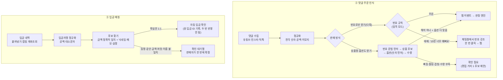

- **댓글 인식**은 오탐(주문이 아닌데 주문으로 처리)이 더 위험하다. 그래서 엄격한 규칙으로 먼저 거른다. 예를 들어 "15번 너무 예뻐요", "3개 남았나요?"는 숫자가 있어도 주문이 아니다. 애매한 것은 사람에게 넘긴다.
- **옵션 인식**은 판매자가 상품에 정한 선택지 이름·별칭만 읽는다. 옵션에 든 숫자(`아이폰 17 프로`의 17)를 먼저 옵션으로 보고, 남은 숫자를 수량으로 본다. 상품명 없이 옵션만 쓴 댓글(`흰색 대형 2개`)은 "지금 상품"으로 보낸다(바뀐 지 15초 안이면 확인 필요). 파서 정답 시험 596개(옵션 댓글 사례 포함)로 고정했다.
- **다음 단계(계획)**: 규칙이 놓치는 표현("15 저요", 이모지 섞인 댓글, 비슷한 옵션 이름)은 LLM이 **확인 필요 화면의 제안으로만** 돕는다. 판매자가 고르기 전엔 아무 기록도 바뀌지 않고, 엔진은 제안을 모른다(D-O-11, CMT-06). 시험 데이터로 오탐률이 기준을 넘지 않을 때만 켠다.

#### AI로 만드는 개발 방식(하네스)

라이브지니는 만드는 과정에도 AI를 쓴다. 역할을 나눈 AI 에이전트들이 스펙을 기준으로 서로 검증하며 개발한다.

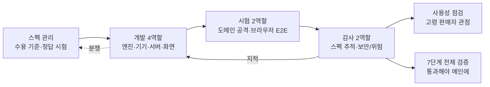

| 장치 | 내용 |
|---|---|
| 진실의 원천 | 요구사항 명세·판정 규칙·요금 규칙·정답 시험(골든 시나리오 약 750개)이 기준이다. 코드가 스펙과 다르면 코드를 고친다 |
| 역할 분리 | 스펙 관리 1, 개발 4(엔진·기기·서버·화면), 시험 2(도메인 공격·브라우저), 감사 2(스펙·위험), 사용성 1. 개발자는 시험 파일을 고칠 수 없다(보호 경로 검사). 커밋 머리말로 역할을 표시하고 게이트가 검사한다 |
| 자동 게이트 | 메인에 넣기 전 7단계 전체 검증: 타입 검사·린트·단위 시험(약 5,400)·정답 시험(약 750)·공격 시험(약 1,280)·브라우저 시험(약 620)·코드 범위. 시험을 약하게 고치는 것(건너뛰기·기대값 맞춰 고치기·실패 시험 삭제)은 금지다 |
| 결정 기록 | 모호한 점은 판매자에게 안전한 쪽(실수·분쟁·데이터 손실이 덜 나는 쪽)으로 정하고 결정 기록에 `AUTO`로 근거를 남긴다(2026-10-22 기준 약 370건) |
| 병렬 트랙과 통합 | 서로 다른 기능(옵션 엔진·옵션 화면·옵션 문서, 문자찜 잠금 등)을 별도 작업 폴더에서 동시에 개발하고, 메인을 합친 뒤 전체 검증을 다시 통과해야 넣는다 |
| 실물 대신 가짜 | 외부 계정·실물 기기가 필요한 부분은 127.0.0.1 가짜 서버(유튜브·메타·포트원·팝빌·OAuth·택배사)와 시험용 프린터로 만들고, 실물 확인 목록으로 따로 모은다 |

이 방식 덕분에 개발 착수 5일(2026-10-18~22) 만에 다육 라이브 판매 24개 묶음과 업종 확장(상품 옵션)을 메인에 넣었다.

#### 기대효과(AI)

| 지표 | 지금(사람·수기) | 라이브지니 목표 | 근거 |
|---|---|---|---|
| 상품 1개 등록 | 스태프가 받아 적는다 | 말하기 + Enter 1번(또는 한 줄 입력) | SPEC 성공 기준 |
| 받아 적는 스태프 | 방송마다 1명(회 약 10만 원) | 0명 | 음성 등록 + 자동 판정 |
| 선착순 판정 오류 | 채팅이 빠르면 생긴다 | 방송 1회(상품 100개·채팅 3,000건) 리허설 기준 0건 | 규칙 엔진 + 정답 시험 |
| 옵션 댓글 잘못 판정 | 눈으로 읽다 사이즈·색을 틀린다 | 자동 판정 오류 0건(애매한 것은 모두 확인 필요로) | 정확히 같은 이름·별칭만 자동 |
| 방송 후 정산 | 엑셀로 몇 시간 | 방송 종료 후 10분 안에 전원 영수증·판매대장 | SPEC 성공 기준 |
| 입금 대조 | 은행 앱과 엑셀을 눈으로 대조 | 확실한 건은 자동, 애매한 건만 한 화면에서 확정 | 입금 매칭 |
| 택배 입력 | 택배사 사이트에 한 건씩 옮겨 적음 | 묶음을 골라 한 번에 접수(진행 중) | T1 |

> 위 목표치는 설계 목표다. 실제 효과는 출시 전 리허설(HG-1)과 첫 실방송에서 잰다.

---

## 3. 결과물 활용 방안 및 기대효과

### 3.1 실제 사용자와 활용처

| 사용자 | 활용처 | 쓰는 방식 |
|---|---|---|
| **다육 농장주(1차 고객)** | 유튜브 다육 라이브 판매. 월 2회 안팎, 1부~3부 | PC 콘솔 + 휴대폰 프린트 스테이션. "번호로만 받기", 라벨을 켜고 쓴다 |
| 보조자(가족·직원) | 같은 방송의 문자 찜 입력, 포장 | 휴대폰의 보조자 계정(문자 찜·포장 권한만) |
| 라벨을 쓰지 않는 판매자 | 인스타·틱톡 라이브. 방송 후 바로 영수증만 보낸다 | 라벨을 끄고 확인서 그림·공유 링크·엑셀·입금 확인만 쓴다 |
| **업종 확장 판매자(2차 고객)** | 식품·농수산물, 화분·꽃, 의류·잡화, 휴대폰 케이스 라방 | "상품명·옵션도 받기" + 업종 템플릿. 옵션 댓글 → 변형별 판정 → 확인 필요 처리 → 영수증·입금 → 포장·택배 접수 |
| 구매자(시청자) | 댓글로 찜하고 공유 링크로 내역·입금 계좌·(진행 중) 배송지 입력·배송 조회를 한다 | 로그인 없이 자기 구매 내역만 보는 공유 링크 |

### 3.2 적용 방안(도입 단계)

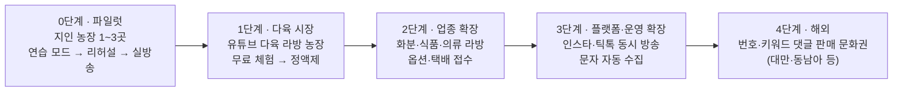

| 단계 | 하는 일 | 성공 기준 |
|---|---|---|
| 0. 파일럿 | 연습 모드(`pnpm try`)로 판매자가 혼자 써 본다. 실제 농장 방송에서 리허설(HG-1)과 실방송을 한다. B1·Marklife 실출력(HG-2), 유튜브 비공개 테스트 방송(HG-3) | 방송 1회를 스태프 없이 끝낸다. 판정·금액 오류 0건 |
| 1. 다육 시장 | 무료 체험(운영자 부여 이용권), 정액제 전환, 사용 후기 영상 | 체험 → 유료 전환율, 월 이탈률 |
| 2. 업종 확장 | 옵션 통합 시험(O4) 마무리, 업종 템플릿(식품·화분·의류·휴대폰 케이스), 택배 자동 접수(T1), 간편 로그인(L1) | 다육 외 판매자 비율, 확인 필요 비율(옵션 댓글 중 판매자가 고친 비율), 택배 접수 자동화 비율 |
| 3. 플랫폼·운영 확장 | 인스타 앱 심사 통과, 틱톡 베타 판단, 문자 자동 수집(붙여넣기 → 안드로이드 자동 전달 → 전용 수신 번호), LLM 보조 제안 | 여러 플랫폼 동시 방송 판매자 비율, 문자찜 손 입력 감소 |
| 4. 해외 | 다국어, 현지 결제·입금·택배 연동 | 첫 해외 판매자 |

### 3.3 수익모델(BM)

**요금 원칙**(요금 규칙 [BILLING_RULES](spec/BILLING_RULES.md), 결정 D-N5-01~14)

- 사람(회 10만 원)이나 기존 AI(회 9만 원)보다 **확실히 싸게**. 월 2회 방송 농장이 정액제를 자연스럽게 고르게 한다.
- **판매를 멈추지 않는다.** 이용권이 막는 것은 "새 실제 방송 시작" 하나다. 시작한 방송은 이용권이 떨어져도 끝까지 된다. 판매 기록·정산·입금·문서·포장·백업은 언제나 된다. 리허설은 요금과 상관없다.
- **돈이 아니라 이용권.** 원 단위 충전금·포인트·넘기기·출금은 없다(선불업 위험을 만들지 않는다). 돈을 돌려받는 길은 결제 후 7×24시간 안, 전혀 쓰지 않은 이용권의 전액 결제 취소 하나다.
- 자동 갱신(빌링키)은 지금 없다. 넣을 때는 판매자가 따로 동의한 경우에만 한다.
- 결제는 포트원 V2(토스페이먼츠 채널), 카드·계좌이체. 계좌이체 결제는 증빙(세금계산서·현금영수증) 요청을 기록한다. 가격은 부가세 포함으로 표시한다.

| 이용권(시스템 종류) | 단위 | 대상 | 제안 가격(안) | 비교 |
|---|---|---|---|---|
| **정액제 30일**(`FLAT_30D`) | 30×24시간. 이용 중에 시작하는 모든 실제 방송은 아무것도 세지 않음. 이어 사면 끝에 이어 붙음 | 월 2회 이상 방송하는 농장·업종 판매자. 기본 상품 | 29,000원 | 월 2회(4시간) 기준 스태프 약 20만 원, 도움봇 AI 약 10만 원 + 프린터 45만 원. 범용 라방 도구 월 3.3만~20만 원 |
| **방송 일권**(`DAYS`) | 1일 = 쓴 때부터 24시간 창(자정 넘긴 2부도 한 번) | 가끔 방송하는 판매자 | 1일 9,900원 / 10일 묶음 할인 | 스태프 회당 4.5만~15만 원, 도움봇 AI 4만 원(3시간)+시간당 1만 원·보급형 2만 원(일) |
| **주문 건권**(`ORDERS`) | 1건 = 1등이 처음 나온 상품 하나(승계·취소·재고 여럿이어도 1건) | 방송은 드물지만 상품 수가 적은 판매자 | 100건 묶음(가격 미정) | 범용 도구의 매출 2~3.8% 수수료 |
| **라벨 장권**(`LABELS`) | 정량 방식 방송의 상품 라벨 1장. 다 써도 막지 않고 초과로 보임 | 일권·건권으로 라벨을 쓰는 판매자 | 100장 묶음(실비 수준) | 도움봇 전용 라벨 장당 100원 |
| 부가: 입금 자동 확인 | 계좌당 월 | 입금이 많은 판매자 | 팝빌 계좌조회 원가 연동(실비 수준) | 붙여넣기는 무료 |
| 부가: 택배 접수 | 건당 | 택배를 많이 보내는 판매자 | 택배사 계약 단가 + 소액(추정, 계약 뒤 확정) | 택배사 사이트 손 입력 |
| 부가: 알림톡 영수증 발송 | 건당 | 구매자에게 자동 발송을 원하는 판매자 | 실비 + 소액 | 문자보다 싸다 |
| 제휴: 프린터·라벨 번들 | 판매 수수료 | 프린터가 없는 신규 판매자 | — | 전용 장비 강매가 아니라 선택형 |

> 가격 숫자는 사업 결정이라 아직 열려 있다(D-014). 시스템에는 요금 구조(이용권 네 종류·요금 표·켜고 끄는 스위치·막는 곳)가 완성돼 있고, 가격은 자리 표시값이라 이대로는 운영 서버가 요금 기능을 켜지 않는다(D-N5-12). 위 제안가는 파일럿 판매자 인터뷰와 체험 전환율을 보고 확정한다. 기능을 나눈 요금제(예: 보조자 여러 명·클라우드 음성 포함 상위 요금제)는 지금 구조에 없고, 필요하면 나중에 더한다.

**매출 계획(연말 기준 연 환산, 추정)**

| 연도 | 유료 판매자 | 월 평균 객단가(ARPU) | 이용권 매출 = 판매자 × ARPU × 12 | 부가·제휴(이용권의 15% 가정) | 연 환산 매출 | 처리 거래액(SOM) |
|---|---|---|---|---|---|---|
| 2027 | 300명 | 2.9만 원 | 1.04억 원 | 0.16억 원 | **약 1.2억 원** | 240억 원 |
| 2028 | 1,200명 | 3.0만 원 | 4.32억 원 | 0.65억 원 | **약 5.0억 원** | 960억 원 |
| 2029 | 3,000명 | 3.1만 원 | 11.16억 원 | 1.67억 원 | **약 12.8억 원** | 2,400억 원 |
| 2030 | 5,000명 | 3.2만 원 | 19.20억 원 | 2.88억 원 | **약 22.1억 원** | 4,000억 원 |
| 2031 | 7,000명 | 3.3만 원 | 27.72억 원 | 4.16억 원 | **약 31.9억 원** | 5,600억 원 |

- 객단가는 정액제(2.9만 원) 중심에 방송 일권·건권·라벨 장권 추가 구매가 섞인 평균이다. 방송이 잦은 업종 판매자의 정량 추가 구매가 늘면서 조금씩 오른다고 가정했다(추정). 처음 기획은 상위 요금제(5.9만 원)를 넣어 ARPU 4.0만 원까지 봤지만, 지금 요금 구조에 맞춰 낮췄다.
- 원가: 서버·DB·백업은 판매자 수에 비해 작다. 입금 연동(팝빌)·택배 접수·알림톡은 실비를 받아 원가를 넘기지 않는다. 클라우드 음성 인식(시간당 수백~천 원)은 켜는 판매자에게만 쓴다.
- 확장 옵션: 앞으로 구매자 결제(카드·간편결제 링크)를 붙이면, 처리 거래액에 작은 결제 수수료를 받는 모델을 더할 수 있다. 예를 들어 5,600억 원 × 0.3%면 연 16.8억 원이다. 이 경우 전자금융·PG 계약 요건을 먼저 검토한다.

### 3.4 사업화 계획

**운영 주체와 현황(2026-10-22)**

| 항목 | 상태 |
|---|---|
| 사업자 | 개인사업자 **틈(TEUM)**, 간이과세자 |
| 업종 | 응용 소프트웨어 개발·공급업 추가(2026-10-22) |
| 통신판매업 | 신고 완료(2026-03). 상호·도메인이 정해지면 변경 신고 |
| 도메인 | livegenie.kr·livegenie.co.kr 확보 가능, livegenie.com은 이미 등록됨 |
| 제품 | 다육 24개 묶음·상품 옵션 완성. 옵션 통합 시험·간편 로그인·택배 접수 진행 중. 외부 연결은 가짜 서버로 시험 완료 |

**사업화 순서(사장님 할 일)** — 앞 단계가 뒤 단계의 서류·주소가 된다. 자세한 방법은 [OWNER-GUIDE](OWNER-GUIDE.md)에 있다.

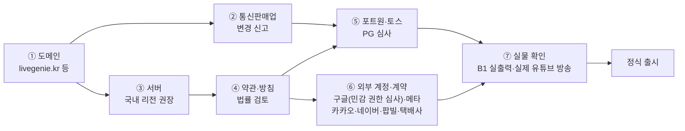

| 순서 | 할 일 | 왜 필요한가 |
|---|---|---|
| ① | 도메인 확보(상표 확인과 함께) | 간편 로그인·유튜브·인스타·결제 모두 "돌아오는 주소"를 등록해야 한다 |
| ② | 통신판매업 변경 신고 | 상호·사이트 주소를 신고 내용과 맞춘다. PG 심사가 신고증을 본다 |
| ③ | 서버(국내 리전 권장) | 개인정보를 국내에 두면 국외 이전 고지가 필요 없다. 컨테이너 1개 + 관리형 PostgreSQL |
| ④ | 약관·방침 법률 검토 | 개인정보 **수탁자** 지위와 처리 위탁 조항, **7일 환불**(쓴 이용권의 철회 제한 고지), **선불전자지급수단 해당 여부**, 광고 수신 동의, 틱톡 약관 위험 |
| ⑤ | 포트원 가입·토스페이먼츠 PG 심사 | 실제 이용권 결제. 사이트에 가격·약관·사업자 정보가 보여야 한다 |
| ⑥ | 구글(유튜브 민감 권한 심사·로그인), 메타(인스타 권한 심사·비즈니스 인증), 카카오·네이버(로그인 앱·검수), 팝빌(계좌조회·세금계산서), 택배사(접수 API 계약) | 실제 채팅·감사 메시지·간편 로그인·입금 자동 확인·택배 접수 |
| ⑦ | 실물 확인 | 실제 B1(블루투스·USB·한글·30장 연속), Marklife·바우아토, 실제 유튜브 비공개 테스트 방송, 실제 목소리, 실제 휴대폰, 리허설 1회 |

| 시기 | 제품 | 시장·영업 |
|---|---|---|
| 2026년 4분기 | 옵션 통합 시험(O4), 간편 로그인(L1), 택배 자동 접수(T1). 실물 확인 | 도메인·서버·법률 검토·PG 심사·구글/메타 심사 신청. 파일럿 농장 리허설·실방송 |
| 2027년 1분기 | 정식 출시(유튜브 + 인스타). 이용권 결제. 업종 템플릿 공개 | 무료 체험 캠페인. 홍보 계정(인스타·블로그·당근·틱톡) 운영과 광고 |
| 2027년 2~3분기 | 문자 자동 수집 1단계(붙여넣기 해석), 알림톡 영수증, 판매 리포트, 틱톡 정식 여부 판단(법률 검토 후) | 다육 커뮤니티·농업기술센터·화훼 박람회. 식품·의류 라방 판매자 모임. 프린터 판매처 제휴 |
| 2027년 4분기~ | 안드로이드 자동 전달·전용 수신 번호, LLM 보조 제안(확인 필요 화면), 판매 비서(요약·추천) | 식품·의류·잡화 라방으로 본격 확장 |
| 2028년~ | 다국어·해외 결제·택배 연동 | 대만·동남아 등 댓글 주문 판매 문화권 |

**마케팅 채널**

- **홍보 계정·광고**: 인스타그램·네이버 블로그·당근·틱톡에 홍보 계정을 만들고 "라벨 자동 출력 시연", "옵션 댓글이 알아서 정리되는 장면" 같은 짧은 영상을 올린다. 다육 라방 시청자층과 의류·식품 라방 판매자를 겨냥해 광고한다.
- **현장 신뢰**: 파일럿 농장의 실제 방송 전후 비교 영상(스태프 없이 끝낸 방송)을 만든다. 연습 모드로 직접 눌러 보게 한다.
- **커뮤니티**: 다육 카페·밴드, 지역 농업기술센터 교육, 화훼·다육 박람회 부스, 라방 판매자 커뮤니티.
- **판매자 소개**: 소개한 판매자와 소개받은 판매자 모두에게 정액제 1개월을 준다(운영자 부여 이용권).
- **문자 홍보 주의**: 판매자에게 광고 문자를 보내려면 **받는 사람의 사전 동의**가 필요하다(정보통신망법 제50조). 동의 없는 대량 문자는 과태료 대상이다. 공개된 연락처로 처음 연락할 때는 광고가 아닌 개별 안내·방문으로 하고, 체험 신청 때 수신 동의를 받는다.

### 3.5 지식재산·연구·기술 제휴

| 구분 | 내용 | 비고 |
|---|---|---|
| **특허(후보)** | ① 라이브 방송에서 지난 상품 번호의 늦은 주문, 공개 전 주문, 채널 간(채팅·문자) 경합을 처리하는 선착순 판정 방법. ② 방송자 발화에서 상품 정보를 뽑고 판매 이력 사전으로 품종명을 바로잡아 확인 카드로 등록하는 방법. ③ 서로 다른 라벨프린터 프로토콜에 같은 1비트 라벨 그림을 출력하는 출력 대기열·재출력 관리 방법. ④ 라이브 댓글에서 상품·옵션·수량을 읽어 변형별 선착순을 판정하고, 애매한 댓글은 확인 대기열에 두었다가 원래 순위로 확정하되 이미 정해진 1등을 밀어내지 않는 방법 | 출원 전 선행 기술 조사를 한다. 이 기획서를 외부에 공개하기 전에 출원하거나, 공지 예외 주장 기간(공개 후 12개월) 안에 출원한다 |
| **상표** | 서비스 이름 "라이브지니(LiveGenie)" 상표 출원(소프트웨어·온라인 서비스 류). **KT '지니' 계열 상표와의 유사성**이 위험이라 키프리스 검색·변리사 확인을 먼저 한다 | 확인 전까지 가칭. 막히면 대안 이름 |
| **도메인** | livegenie.kr·livegenie.co.kr 확보(가능). livegenie.com은 이미 등록됨 | 상표 확인과 함께 |
| **논문·발표** | ① 이벤트 기록 기반 결정적 선착순 판정과 속성 기반 시험 검증(정답 시험 약 750개 + 무작위 속성 시험). ② 한국어 라이브커머스 발화·댓글에서 상품·옵션·수량 추출(한글 수사·금액 해석, 옵션 숫자 구분, 자모 유사도 교정). ③ 다중 AI 에이전트로 스펙 중심 개발을 하는 하네스 사례(역할 11개·7단계 게이트·병렬 트랙) | 국내 학술대회(한국정보과학회·한국전자거래학회 등) |
| **기술 제휴** | 라벨프린터 국내 총판(NIIMBOT·Marklife: 정품 라벨 번들, 상업 사용 동의), 팝빌(계좌조회·세금계산서), 포트원·토스페이먼츠(결제), 카카오·네이버·구글(로그인), 택배사(접수 API·운송장 양식), 알림톡 발송 대행사 | [OWNER-GUIDE](OWNER-GUIDE.md) 참조 |
| **오픈소스** | 프린터 프로토콜은 MIT 등 허용 라이선스 구현만 참고한다. GPL 코드는 복사하지 않는다. 직접 만든 한글 금액 파서 등은 공개해 신뢰를 쌓는 방안을 검토한다 | 라이선스 준수 |

### 3.6 기대효과

#### 사용자 측면

| 효과 | 내용 |
|---|---|
| **비용 절감** | 받아 적는 스태프(회당 4.5만~15만 원)가 필요 없다. 월 2회 방송에 회당 10만 원이면 월 20만 원 → 정액제 2.9만 원(제안가)으로 **약 85% 줄어든다.** 도움봇 대비 프린터 45만 원(또는 하루 3만 원 대여)과 전용 라벨값(장당 100원)이 들지 않는다 |
| **판매 기회 증가** | 방송을 돌려보는 시청자의 늦은 찜과 문자 찜을 놓치지 않는다. 취소되면 대기자에게 자동으로 넘어가 재판매가 된다. 옵션 상품은 `M`이 다 팔려도 `L`을 계속 판다 |
| **실수·분쟁 감소** | 선착순·중복 판매·옵션·금액 계산을 규칙 엔진이 처리한다. 애매한 댓글은 자동으로 정하지 않는다. 다툼이 생기면 기록으로 "누가 몇 시 몇 초에 먼저 썼는지" 보여 준다 |
| **시간 절약** | 방송 후 정산·명세서·입금 대조가 몇 시간에서 10분 안으로 준다. 택배 접수까지 묶으면(진행 중) 포장 뒤 손 입력도 사라진다 |
| **편의성** | 설치 없이 웹으로 쓴다. 휴대폰과 PC가 실시간으로 같다. 시작 마법사, 연습 모드, 쉬운 한국어, 큰 버튼, 간편 로그인(진행 중). 고령 판매자도 혼자 방송할 수 있다 |
| **장비 자유** | 이미 가진 프린터를 그대로 쓴다. 라벨을 쓰지 않으면 꺼 두고 영수증만 보낸다 |
| **구매자 경험** | 구매 직후 감사 메시지를 받는다. 공유 링크로 자기 내역과 입금 계좌를 바로 확인하고, 배송지를 넣고, 송장을 조회한다 |

#### 비즈니스 측면

| 효과 | 내용 |
|---|---|
| **수익 창출** | 이용권(정액제·일권·건권·장권)으로 매달 반복되는 매출을 만든다. 서버 비용이 판매자 수에 비해 작아 이익률이 높다. 부가 서비스(입금 연동·택배 접수·알림톡)와 제휴 수수료가 더해진다 |
| **확장성** | 프린터·플랫폼·로그인·택배사는 어댑터로, 업종은 옵션 모델과 템플릿으로 넓힌다. 다육 → 식품·화분·의류·잡화 → 해외로 같은 제품을 판다 |
| **데이터 자산** | 품종·옵션·가격·판매 속도 데이터가 쌓인다. 판매자의 다음 방송 추천과 시장 시세 정보로 쓴다(판매자 동의·익명화 전제) |
| **고용 창출** | 운영·고객지원·현장 교육(농가 방문 설치 지원) 인력이 필요하다. 판매자 수에 따라 단계적으로 채용한다(아래 표) |
| **지역·농가·소상공인 디지털 전환** | 고령 농가와 소상공인의 온라인 직판을 돕는다. 유통 단계를 줄여 소득에 기여한다 |

**고용 계획(추정)**

| 연도 | 인원 | 구성 |
|---|---|---|
| 2027 | 4명 | 개발 2(제품·서버), 운영·고객지원 1, 영업·현장 교육 1 |
| 2028 | 7명 | 개발 3, 운영·고객지원 2, 영업·교육 2 |
| 2029 | 12명 | 개발 5(플랫폼·AI 포함), 고객지원 3, 영업·교육 3, 경영지원 1 |
| 2031 | 20명 안팎 | 개발 8, 고객지원 5, 영업·교육·제휴 5, 경영지원 2 |

- 현장 교육 인력은 농업기술센터·지역 농가를 찾아가 설치와 첫 방송을 돕는다. 지역 일자리와 농가 디지털 전환이 함께 생긴다.
- 고객지원은 방송 시간(저녁·주말)에 맞춰 운영한다. 판매자의 방송 중 문의에 바로 답하는 것이 이탈을 막는 핵심이다.

---

## 부록 A. 출처

모두 2026-10-20에 확인했다. 괄호 안은 원문 게시일이다. 개정(2026-10-22)에서는 새 출처를 더하지 않았다. 새로 넣은 업종 확장 숫자는 출처가 없어 본문에 "추정"으로 표시했다.

**경쟁 서비스(국내)**
1. 도움봇 서비스 소개, 네이버 블로그(2026-10-06) — https://m.blog.naver.com/PostView.naver?blogId=mobilemania&logNo=224433511980
2. 도움봇 유튜브 채널 — https://www.youtube.com/@도움봇-7
3. 라이브챗오더 — https://livechatorder.com/pricing
4. 라방ERP·위잉치킨 — https://labangerp.com/
5. 라이브마켓 — https://service.livemarket.pro/ · https://business.livemarket.pro/youtube-live-order/
6. 셀리브 — https://shop.markety.co.kr/
7. LiveOrder — https://liveorder.kr/ · 크롬 웹 스토어 등록 정보
8. Moaply — https://moaply.eane.at/
9. 챗오더 — https://www.chatorder.co.kr/
10. 라이브버디 — https://livebuddy.kr
11. 모루라이브 블로그, 문의 379건 분석(2026-08-28) — https://blog.naver.com/morulive/224392921174
12. 샌드라이브 — https://sendlive.kr/
13. Sellvit AI 매니저 — 크롬 웹 스토어 등록 정보
14. 주문하마 — https://hipporder.com/
15. 엑스플랜트 — https://www.xplant.co.kr/
16. 라이브 플랫폼 수수료 비교(2026-06-25) — https://1point.kr/blog/?p=7331
17. 틱톡 라방 채팅 연동 실무 답변, 네이버 지식iN(2026-08-12) — https://kin.naver.com/qna/detail.naver?dirId=10610&docId=494709863

**사람 스태프**
18. 당근 구인 「라이브 주문 받아 적기」 일급 15만 원(2024-10-22) — https://jobs.daangn.com/job-posts/z6pxj6299dxe
19. 당근 구인 「라이브 저녁 방송 보조 전산업무」 시급 10,500원(2025-05-22) — https://www.daangn.com/kr/jobs/라이브-저녁-방송-보조-전산업무-sqzdow5zhp74/
20. 당근 구인 「라이브 주문 엑셀 입력」 시급 13,000원(2025-08-15) — https://jobs.daangn.com/job-posts/hqn4t4rzvary
21. 당근 구인 「라방 접수 엑셀·입금 확인」 회당 45,000원(2025-12-17) — https://jobs.daangn.com/job-posts/63an9vaj9x5q
22. 밴드 라방 알바 후기(2026-01-28) — https://blog.naver.com/iamarich_/224162616560
23. 네이버 카페 '꽃사랑 다육사랑 장터' 라방 알바·후기 글(2025-12 ~ 2026-05) — https://cafe.naver.com/plantremarket/1925675 외

**해외 사례**
24. CommentSold — https://try.commentsold.com/
25. Permira, CommentSold 투자 발표(2021) — https://www.permira.com/news-and-insights/announcements/commentsold-accelerates-plans-to-democratize-livestream-e-commerce-with-investment-from-permira
26. SHOPLINE 라이브 판매 — https://shopline.hk/en/live-stream
27. SoldLive(Shopify 앱) — https://apps.shopify.com/soldlive
28. Selmo(Shopify 앱) — https://apps.shopify.com/selmo
29. Whatnot 투자·거래액: Tubefilter(2025-10) https://www.tubefilter.com/2025/10/31/whatnot-series-f-funding-round-ecommerce-creator-economy/ · PYMNTS(2026) https://www.pymnts.com/?p=4051630
30. Modern Retail, 식물 라이브 판매(2024) — https://www.modernretail.co/technology/definitely-not-on-my-bingo-card-plants-are-the-latest-live-shopping-trend/
31. Palmstreet: RetailBoss(2025) https://retailboss.co/?p=13146 · Forbes Australia(2025) https://www.forbes.com.au/life/lifestyle/houseplant-sells-for-26000-on-palmstreet-app-breaking-recent-record/
32. Retail Dive, 페이스북 라이브 쇼핑 종료(2022) — https://www.retaildive.com/news/facebook-meta-shut-down-live-shopping-feature/628795/
33. TechCrunch, 인스타그램 라이브 쇼핑 종료(2023) — https://techcrunch.com/2023/02/14/instagram-is-killing-live-shopping-in-march-will-focus-on-ads-instead

**시장 규모·통계**
34. 매일경제, 라방바 데이터랩 국내 라이브커머스 거래액(2026-01-08) — https://v.daum.net/v/20260108174518652
35. 세계일보, 국세청 SNS마켓업 등록자(2025-09-27) — https://www.segye.com/newsView/20250926506244
36. 블로터, 그립 셀러 수(2026-06-16) — https://byline.network/2026/06/16_2901827835/
37. 유튜브 공식 블로그, 유튜브 쇼핑(2025-07-28) — https://blog.youtube/intl/ko-kr/news-and-events/youtube-shopping-accelerator-2025/
38. 디지털데일리, 틱톡샵 국내 미출시(2026-08-26) — https://www.ddaily.co.kr/page/view/2026082614511945588
39. 경기도농업기술원 시험연구보고서(2023) — https://nongup.gg.go.kr/wp-content/uploads/sites/2/2024/06/report_23_cact_10.pdf
40. 경기도농업기술원 시험연구보고서(2025) — https://nongup.gg.go.kr/wp-content/uploads/sites/2/2026/06/report_25_cact_12.pdf
41. 헤럴드경제, 2025 농림어업총조사 잠정 결과(2026-04-27) — https://www.heraldk.com/article/2026042722052055485
42. 뉴스서울, 농촌진흥청 반려식물 시장(2025) — https://www.newsseoul.co.kr/news/view/1065583217142211
43. Grand View Research, Live Commerce Market(2026) — https://www.grandviewresearch.com/industry-analysis/live-commerce-market-report
44. Momentum Works, 동남아 이커머스(2026) — https://thelowdown.momentum.asia/new-report-southeast-asias-platform-ecommerce-reaches-us157-6b-in-2025-with-top-platforms-expanding-share-to-98-8/
45. 유안타증권, 세포마켓 추정(2020-12-02) — https://file.alphasquare.co.kr/media/pdfs/company-report/유안타20201202KG모빌리언스.pdf
46. 중소벤처기업부 2024 소상공인 실태조사(뉴스시안 보도) — http://www.newsian.co.kr/news/articleView.html?idxno=87195
47. 세정신문, SNS마켓업 종합소득세 신고(2025-09-29) — https://www.taxtimes.co.kr/mobile/article.html?no=271648
48. 농림축산식품부, 2022 화훼재배현황 — https://www.mafra.go.kr/bbs/home/792/570896/download.do
49. 뉴시스, 2026 라이브커머스 제작·운영 지원(2026-08-20) — https://www.newsis.com/view/NISX20260820_0003755601
50. 네이버 쇼핑 'NIIMBOT B1' 검색(시노링크 공식몰 B1 PRO 59,000원)

## 부록 B. 이 기획서의 숫자를 읽는 법

- **실제 값**: 경쟁사 요금, 시장 집계, 통계는 위 출처의 공개 자료다. 업체 홈페이지 요금은 바뀔 수 있다.
- **저장소 값**: 커밋 수(906), 코드 줄 수(약 22만, TypeScript·시험 포함), 시험 파일 수(453), 시험 개수(단위 약 5,400·골든 약 750·공격 약 1,280·브라우저 약 620), 결정 기록 수(약 370)는 2026-10-22 저장소 기준이다. 개발이 이어지면 바뀐다.
- **추정 값**: TAM 성장률(연 15%), SAM 판매자 수(3만 명)와 판매자당 거래액(0.7억 원), **SAM 업종별 비중**(식품 40%·의류 35%·식물 5%·기타 20%), **SOM 목표(7,000명·0.8억 원·5,600억 원)와 단계별 판매자 수**, ARPU(2.9만~3.3만 원), 부가 매출 비율(15%), 택배 접수 부가 요금, 고용 계획은 근거를 밝힌 가정이다. 파일럿 판매자 인터뷰와 첫 실방송 데이터로 고친다.
- **제안 값**: 이용권 가격(정액제 29,000원·방송 일권 9,900원 등)은 기획 제안이다. 시스템의 요금 표는 자리 표시값이고, 실제 가격은 사업 결정(D-014)으로 정한다.
- **업계 정보**: "사람 스태프 기본 10만 원, AI 기본 9만 원"은 현장 대화에서 들은 말이다. 구인 공고(회당 4.5만~15만 원)와 도움봇 공개 요금으로 범위를 확인했다.
- **처음 기획과 바뀐 숫자**: SOM 4,800억 원(6,000명) → 5,600억 원(7,000명), 2031년 매출 약 33억 원 → 약 32억 원(상위 요금제를 빼고 판매자 수를 늘림). TAM·SAM은 그대로다.
